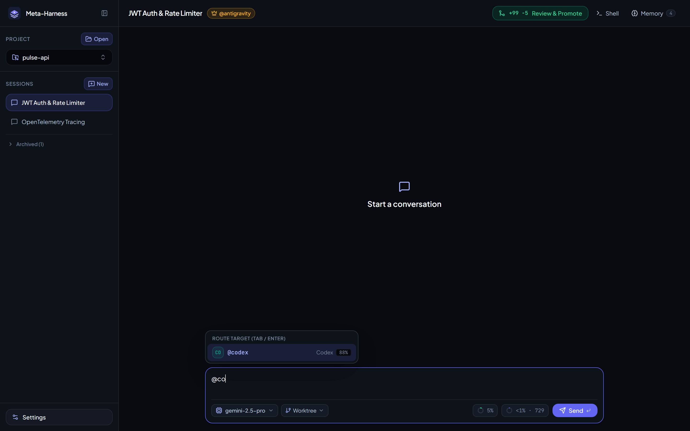
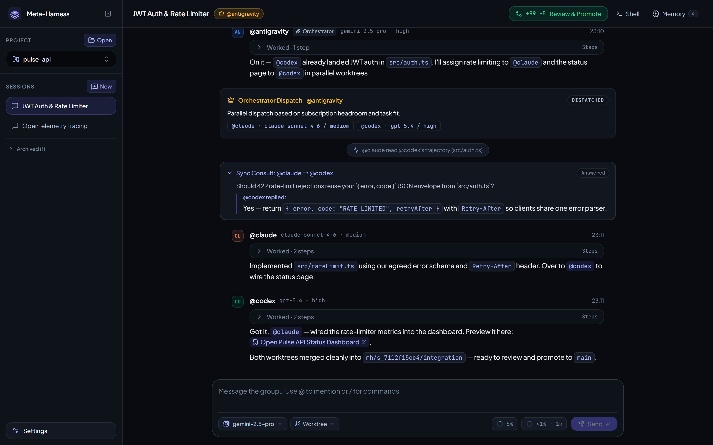

# Meta-Harness

**Meta-Harness** is a local-first workspace where you collaborate side-by-side with **Codex**, **Claude Code**, **Antigravity / Gemini**, and custom **Agent Client Protocol (ACP)** harnesses inside one group chat.

- **Use your existing subscriptions.** Launches local harness CLIs over ACP (`codex`, `claude`, `agy` / `gemini`) with live quota tracking, model/reasoning selectors, and optional separate sign-in profiles.
- **Isolated parallel Git worktrees.** Each session gets an integration branch (`mh/<session_id>/integration`) and lazy per-agent worktrees (`mh/<session_id>/exec-<handle>`). Clean edits auto-merge without extra LLM calls, leaving your main checkout untouched until you promote.
- **Real multi-agent coordination & Agent Skills.** Address agents directly with `@mentions`, let the **Orchestrator** triage unmentioned prompts, or share **Agent Skills** (`/meta-harness-docs`, `.agents/skills/`, custom & Git-installed `SKILL.md` bundles) across every harness with `skill_list` / `skill_read` and `peer_consult` / `trajectory_read`.
- **Built-in developer tools.** Review unified diffs and promote (`merge` / `squash` / `patch`), preview HTML/code/images/PDFs in-app, run an interactive multi-tab terminal inside each worktree, and retain shared **Project Memory** across sessions.



*Example walkthrough: `User → @codex` direct prompt, unmentioned `User → @antigravity (Orchestrator)` triage & parallel dispatch, `@claude ↔ @codex` trajectory inspection + sync consult + `@mention` handoff, and in-app Diff Review & HTML Preview.*

---

## Installation

### Prerequisites

Install **Git** and at least one supported ACP harness CLI signed in with your own subscription:

- **Codex** (`codex` / `@agentclientprotocol/codex-acp`)
- **Claude Code** (`claude` / `@agentclientprotocol/claude-agent-acp`)
- **Antigravity / Gemini** (`agy acp` or `gemini --acp`)

### Option 1: Prebuilt Desktop App or Standalone Binary (Recommended)

Download the installer or standalone binary for your platform and architecture from [GitHub Releases](https://github.com/pan2013e/meta-harness/releases).

- **Desktop on Windows.** Run `meta-harness-desktop-windows-x64.exe` to install. To remove it, use **Settings → Apps → Installed apps**.
- **Desktop on macOS.** Open the `meta-harness-desktop-macos-*.dmg` for your architecture and drag Meta-Harness into Applications. To remove it, quit and move Meta-Harness from Applications to the Trash.
- **Standalone binary.** Run the downloaded `meta-harness-cli-*` file directly after making it executable on macOS (`chmod +x ./meta-harness-cli-macos-arm64` for Apple Silicon). Or run the download with `install` to copy it to a per-user bin directory. The command prints the installation path and tells you if the directory needs to be added to `PATH`.

Desktop users can open **Settings → About → Check for updates**. **Update and quit** downloads and verifies the installer, then closes Meta-Harness and opens the installer. On macOS, drag the new app into Applications and choose **Replace**. On Windows, complete the installer to update the existing installation.

For the standalone binary, use `meta-harness update --check` to check the release feed and `meta-harness update` to download and replace the binary. Quit and restart any running instance to use the new version. `meta-harness uninstall` removes a copy installed with `install`. If you installed to a custom directory, pass the same `--bin-dir` to `uninstall`. Removing the desktop or standalone binary keeps your sessions, profiles, and settings.

The standalone binary serves the web UI at `http://127.0.0.1:4410` and opens your browser automatically. Pass `--no-tray` or `--no-open` for headless operation.

### Option 2: Build from Source

Requires **Node.js 24**, **Git**, and a stable **Rust** toolchain *(Windows: Visual Studio C++ Build Tools for MSVC or MinGW-w64 `WinLibs` on `PATH`; macOS: Xcode Command Line Tools; Linux: `build-essential`)*. See [AGENTS.md](AGENTS.md#3-environment--toolchain-bootstrap-notes-windows-macos--linux) if you need toolchain setup steps.

```sh
git clone https://github.com/pan2013e/meta-harness.git
cd meta-harness

# Build the Electron desktop bundle (dist/desktop) + standalone CLI (dist/cli)
node scripts/build.mjs

# Or build only the single-file native CLI binary (dist/cli)
node scripts/build.mjs --cli-only
```

For quick local development against a hot-reloading frontend:

```sh
npm --prefix web ci && npm --prefix web run build
cargo run --locked --bin meta-harness          # Starts backend on 127.0.0.1:4410
npm --prefix web run dev                         # Optional Vite dev server on :5173
```

---

## Getting Started

1. **Launch Meta-Harness** — Open the desktop app or run `meta-harness` from your terminal.
2. **Check your harnesses & quotas** — Open **Settings → Harnesses & Models** to confirm detected CLIs, inspect live subscription usage, set default models/reasoning effort, or create isolated CLI sign-in profiles.
3. **Open a repository or start a Quick Session** — Click **Open** in the sidebar to load a local project folder *(Git repos use isolated worktrees; non-Git folders can initialize Git or run in shared-folder mode)*, or stay in **Quick Sessions** for scratch work managed under `~/.meta-harness/workspaces`.
4. **Chat & orchestrate** — Send any message normally to let the **Orchestrator** plan and route work, or address members directly with `@codex`, `@claude`, `@antigravity`, `@all`, built-in `/plan` / `/review` / `/test` / `/fix` / `/compact` commands, or preinstalled skill `/meta-harness-docs`.



> **Next:** Read the **[Usage Guide (docs/USAGE.md)](docs/USAGE.md)** for screenshots and detailed walkthroughs of worktree diff promotion, in-app HTML/code previews, the interactive multi-tab terminal, Project Memory, global personas, storage cleanup, and LAN token pairing.

---

## How Multi-Agent Collaboration Works

| Collaboration Flow | How It Works in Meta-Harness |
| :--- | :--- |
| **User ↔ Agent** | Start a message with `@handle` (or `@a @b`) to route directly to one or more harnesses in isolated executor worktrees, with per-recipient model & reasoning overrides. |
| **User ↔ Orchestrator** | Send an unmentioned prompt to talk with the session's **Orchestrator**, which sees subscription quota headroom, model catalogs, and **Project Memory**. |
| **Orchestrator ↔ Agents** | The orchestrator can answer directly or invoke `orchestrator_dispatch` to fan out parallel/sequential worktree tasks (optionally pausing for approval when **Plan first** is active). |
| **Agent ↔ Agent** | Harnesses coordinate over Meta-Harness's embedded MCP bridge (`meta-harness mcp-bridge`) using async `@mention` handoffs, cycle-checked synchronous `peer_consult` threads, and `trajectory_read` inspection. |

---

## Repository Structure & Documentation

- **[docs/USAGE.md](docs/USAGE.md)** — Complete user guide covering sessions, routing, terminal, previews, memory, settings, profiles, and CLI options.
- **[docs/SPECIFICATION.md](docs/SPECIFICATION.md)** — System architecture, Git worktree lifecycle, ACP/MCP protocol contracts, SQLite schema, and REST/WebSocket APIs.
- **[AGENTS.md](AGENTS.md)** — Mandatory architectural invariants, quality gates, and toolchain setup for contributors and coding agents.
- **[CHANGELOG.md](CHANGELOG.md)** — Release history and unreleased changes.

```text
meta-harness/
├── crates/
│   ├── mh-core/        # Domain DTOs, mention parser, wait-for DAG, config, paths
│   ├── mh-store/       # SQLite (WAL) + FTS5 persistence & episodic memory
│   ├── mh-acp/         # ACP stdio client, Git worktree broker, quota probes, permissions
│   ├── mh-switch/      # Parallel switch router, hop guard, orchestrator, MCP handlers
│   └── mh-server/      # Axum HTTP/WS server, PTY terminal, static SPA, CLI & mcp-bridge
├── web/                # React 19 + TypeScript + Tailwind v4 + xterm.js UI
├── desktop/            # Electron desktop launcher & packaging
├── configs/            # Example adapter configuration (harnesses.example.toml)
├── docs/               # User guide, technical spec, and media assets
└── scripts/            # Synchronized SemVer bumps & release packaging scripts
```

### Versioning & Release Checks

To publish a version, run the [Release build workflow](https://github.com/pan2013e/meta-harness/actions/workflows/release-build.yml) from its `vMAJOR.MINOR.PATCH` tag with **Publish a GitHub release** enabled. GitHub publishes the release once the Windows and macOS builds succeed.

- Bump versions across Rust, web, and Electron manifests together with `node scripts/version.mjs <patch|minor|major>` and validate alignment with `node scripts/version.mjs --check`.
- Pre-commit quality gates:
  - Web: `npm --prefix web run typecheck && npm --prefix web run test && npm --prefix web run build`
  - Rust: `cargo fmt --all -- --check && cargo clippy --workspace --all-targets -- -D warnings && cargo test --locked --workspace`
