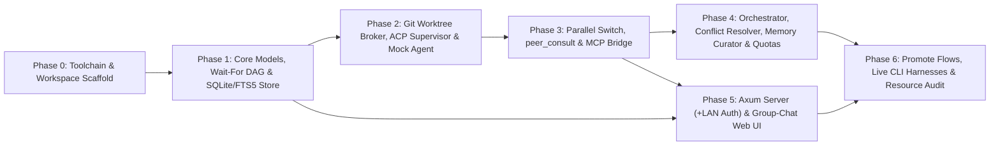

# Meta-Harness Phased Implementation Plan

This roadmap breaks **Meta-Harness** into 7 verifiable phases (**Phase 0 -> Phase 6**) incorporating all finalized architectural decisions (per-harness Git worktrees + session integration branch, parallel turns + deadlock-safe `peer_consult`, adapter-vs-member personas, Orchestrator-curated memory, worktree-smart permissions, and optional token-authenticated LAN mode).

---

## Dependency & Parallelism Map

> [!TIP]
> **Multi-Agent Parallelism**: Once **Phase 1** (`mh-core` + `mh-store` + wire DTOs) lands, backend crates (**Phases 2–4**) and the frontend SPA (**Phase 5**) can be developed in parallel and integrated cleanly in **Phase 6**.

---

## Phase 0: Toolchain Verification & Workspace Bootstrap

### Goals
Ensure Rust and Node toolchains compile cleanly on Windows and scaffold the 5-crate Cargo workspace plus Vite + React 19 + TypeScript frontend.

### Tasks
1. **Rust Toolchain Setup (Windows)**:
   - Verify `cargo --version`. If missing and MSVC `cl.exe` is absent, install `rustup` with `stable-x86_64-pc-windows-gnu` (self-contained ~350 MB setup, zero admin rights; see `AGENTS.md` §3).
2. **Cargo Workspace (`Cargo.toml`)**:
   - Create crates: `crates/mh-core`, `crates/mh-store`, `crates/mh-acp`, `crates/mh-switch`, `crates/mh-server`.
   - Configure `[workspace.dependencies]`: `tokio`, `axum`, `tower-http`, `serde`, `serde_json`, `toml`, `rusqlite` (`features = ["bundled"]`), `agent-client-protocol` (`2.0`), `tracing`, `tracing-subscriber`, `uuid`, `thiserror`, `anyhow`, `which`, `dunce`, `similar`, `hmac`, `sha2`, `rand`.
3. **Frontend Scaffold (`web/`)**:
   - Initialize Vite + React 19 + TypeScript (`strict: true`) + Tailwind CSS v4 + Zustand + `@tanstack/react-virtual` + `lucide-react` + Vitest.

### Verification Gate
- `cargo check --workspace` and `cargo test --workspace` pass.
- `cd web && npm install && npm run typecheck && npm run build` passes.

---

## Phase 1: Core Primitives, Wait-For DAG & SQLite/FTS5 Store (`mh-core`, `mh-store`)

### Goals
Build pure routing/concurrency primitives (`@mention` parser + `peer_consult` deadlock detector) and the SQLite + FTS5 persistence layer.

### Tasks
1. **`crates/mh-core`**:
   - Define domain & wire DTOs separating `HarnessAdapter` (CLI + shared quota bucket) from `SessionMember` (handle, persona, role, worktree).
   - **Code-Aware `@mention` Parser** (`mention.rs`): Masks fenced and inline code before extracting `@handle`, `@handle[model:effort]`, `@all`, and `@orchestrator`.
   - **`WaitForGraph` Cycle Detector** (`dag.rs`): Tracks active `caller -> target` consult edges and detects direct/transitive cycles in `O(V + E)` before permitting `peer_consult`.
2. **`crates/mh-store`**:
   - Embedded SQLite migrations (`WAL` mode) implementing `docs/SPECIFICATION.md` §6.2 (`projects`, `sessions`, `session_members`, `session_permission_rules`, `messages` with `parent_msg_id` threads, `turn_trajectories`, `trajectory_events`, `episodic_jobs` + `episodic_jobs_fts`, `project_facts`).
   - Delta message query (`seq > last_seen_msg_seq`) and FTS5 BM25 memory recall + pin/recency ranking.

### Verification Gate
- `cargo test -p mh-core -p mh-store` verifying mention edge cases, `A -> B -> C -> A` consult cycle rejection, threaded message queries, and FTS5 recall.

---

## Phase 2: Git Worktree Broker, ACP Supervisor & Mock Agent (`mh-acp`)

### Goals
Manage isolated session/member Git worktrees, drive ACP JSON-RPC 2.0 subprocesses safely on Windows, enforce worktree-smart permissions, and validate everything with an offline Mock ACP Agent.

### Tasks
1. **Git Worktree Broker (`crates/mh-acp/src/worktree.rs`)**:
   - Detect Git status (`is_git_repo`, current branch/SHA) and implement 1-click `git init` helper for non-Git folders.
   - Create session integration worktree (`mh/s-<id>`) and lazy per-member executor worktrees (`mh/s-<id>/<handle>`) under `<project>/.meta-harness/worktrees/<session_id>/` (registered in `.git/info/exclude`).
   - Implement auto-commit of dirty executor worktree edits on turn completion, deterministic clean merge into `mh/s-<id>`, structured conflict detection (returning conflicting file paths + diffs without aborting context needed for Orchestrator resolution), idle peer worktree fast-forward sync, and 3 promotion modes (`merge`, `squash`, `patch`) back to `<base_branch>`.
   - Implement clean worktree pruning on session deletion.
2. **Process Supervisor & ACP Client (`supervisor.rs`, `client.rs`)**:
   - Resolve Windows `.cmd`/`.exe` shims via `which`; bind child trees to Win32 Job Objects (`JOB_OBJECT_LIMIT_KILL_ON_JOB_CLOSE`); lazy spawn + idle hibernation reaper.
   - Implement ACP `initialize`, `session/new` (injecting `meta-harness mcp-bridge` + member worktree `cwd`), `session/load`, `session/set_config_option` (`model` + `reasoning_effort`), `session/prompt`, `session/cancel`, and 25ms-coalesced `session/update` capture.
3. **Worktree-Smart Permission Broker (`broker.rs`)**:
   - Auto-approve `fs/read_text_file` in project and `fs/write_text_file` strictly inside the calling member's `dunce::canonicalize`d worktree.
   - Match `terminal/*` and external file requests against `session_permission_rules` (`Allow 'cargo test*' for session`); prompt UI via async oneshot channel when unmatched.
4. **Deterministic Mock ACP Agent (`tests/fixtures/mock_acp_agent.rs`)**:
   - Rust test binary supporting configurable models/efforts, parallel file edits in its assigned `cwd`, permission requests, and scripted MCP tool calls (`peer_consult`, `trajectory_read`, `orchestrator_dispatch`, `memory_curate_job`).

### Verification Gate
- Integration test verifying two `mock_acp_agent` instances editing files **simultaneously** in separate worktrees:
  1. Disjoint file edits auto-merge cleanly into `_integration` with zero conflicts.
  2. Overlapping line edits trigger structured conflict detection ready for Orchestrator escalation.
  3. Worktree-smart permissions auto-allow inside-worktree writes while gating shell commands and outside-worktree writes.

---

## Phase 3: Parallel Network Switch, `peer_consult` & Embedded MCP Bridge (`mh-switch`, `mh-server` CLI)

### Goals
Connect parallel session members over the Switch Bus with async `@mention` routing, synchronous deadlock-free `peer_consult`, `trajectory_read` pills, and hop protection.

### Tasks
1. **Parallel Session Router (`router.rs`)**:
   - Per-member turn queue allowing distinct members (`@codex`, `@claude`, `@codex-reviewer`) to run `session/prompt` concurrently in their own worktrees while serializing turns targeting the *same* member.
   - `<group_chat_updates>` XML delta builder per `SessionMember`.
   - `chain_id` hop budget (`max_hops = 6`) + global `Stop All` (`session/cancel` across all active members + aborting pending consult waits in <250ms).
2. **`mcp-bridge` Subcommand & Switch MCP Handlers (`mcp.rs`)**:
   - Implement `meta-harness mcp-bridge` stdio-to-HTTP forwarder authenticated via `MH_BRIDGE_TOKEN`.
   - Implement `chat_list_peers`, `chat_read_messages`, `chat_send_message`, `peer_consult` (wired to `WaitForGraph` + creating `consult_thread` chat messages), `trajectory_list`, `trajectory_read` (emitting `activity_pill` events), `memory_recall`, and `memory_record_fact`.

### Verification Gate
- Multi-agent switch integration test:
  1. `@mock-a` and `@mock-b` run in parallel; `@mock-a` calls `peer_consult` on idle `@mock-c` mid-turn and receives synchronous reply; mutual `A <-> B` `peer_consult` is caught immediately by `WaitForGraph` without deadlocking.
  2. `@mock-b` calls `trajectory_read` on `@mock-a` and receives paginated diffs while Group Chat records an `activity_pill`.

---

## Phase 4: Orchestrator, Conflict Resolver, LLM Memory Curator & Quota Engine

### Goals
Deliver intelligent unmentioned task routing (including self-brand executor dispatch), automatic merge-conflict escalation, Orchestrator-curated episodic memory, and subscription usage tracking.

### Tasks
1. **Multi-Tier Subscription Quota Engine (`crates/mh-acp/src/quota.rs`)**:
   - Adapter-level `QuotaTracker` (shared across personas of the same `adapter_id`).
   - Safe default telemetry: local CLI session logs (`~/.codex`, `~/.claude`, `~/.gemini`) + Meta-Harness turn accounting + ACP status metadata + reactive `429` circuit breaker calibrated to user plan tier.
   - Opt-in exact quota probe toggle (`exact_quota_probe_opt_in`) per adapter.
2. **Orchestrator Dispatch, Conflict Resolution & Memory Curation (`crates/mh-switch/src/orchestrator.rs`)**:
   - Pre-inject `<orchestrator_telemetry>` into Orchestrator turns; support pragmatic direct replies, auto-dispatch (`orchestrator_dispatch` with live cancel/reroute), and optional `confirm_before_dispatch` mode.
   - Support dispatching to an executor member sharing the Orchestrator's own `adapter_id` (running in `_exec_<handle>` while Orchestrator stays in `_integration`).
   - **Conflict & Wave Escalation**: Automatically wake Orchestrator in `_integration` when `GitWorktreeBroker` encounters merge conflicts or when a multi-executor wave completes.
   - **Curated Memory Pass**: Piggyback `memory_curate_job` onto active Orchestrator merge/synthesis turns, or trigger a lightweight `low`-effort Orchestrator curation pass after clean single-executor merges (with deterministic fallback if no Orchestrator is set).

### Verification Gate
- Integration tests verifying:
  1. Quota-aware failover when primary adapter is `<15%` or `429`, and shared quota accounting when `@claude` (Orchestrator) dispatches to `@claude` (Executor).
  2. Merge conflict between `@mock-a` and `@mock-b` automatically wakes Orchestrator in `_integration`, resolves the conflict cleanly, and writes curated `episodic_jobs` + `project_facts` entries searchable via FTS5.

---

## Phase 5: Axum Server (+ LAN Token Auth) & Responsive Web UI (`mh-server`, `web/`)

### Goals
Build the low-memory HTTP/WS backend (with optional LAN/Tailscale bearer auth) and the user-friendly 3-column Group Chat + Worktree Promotion SPA.

### Tasks
1. **`crates/mh-server`**:
   - REST + `/api/ws` multiplexed WebSocket hub with 25ms delta coalescing and selective trajectory streaming.
   - Localhost (`127.0.0.1:4410`) zero-friction default + `--bind` remote mode with random bearer token / pairing URL -> `HttpOnly` cookie exchange.
   - Static asset embedding (`web/dist`) for single-binary deployment.
2. **`web/` Frontend**:
   - **Left Sidebar**: Project picker (+ 1-click `git init` modal for non-Git folders), Session list, Member Roster (`+ Add Persona`, Orchestrator crown toggle, live parallel status badges, shared adapter 5h/Weekly quota bars).
   - **Top Session Changes Bar**: Ahead/behind stats for `mh/s-<id>`, cumulative diff viewer modal, **"Preview/Shell in Session Worktree"** launcher, and 3-mode **Promote** dropdown (`Fast-Forward / Merge`, `Squash Merge`, `Apply Patch`).
   - **Center Virtualized Group Chat**: Multi-agent markdown bubbles, Orchestrator Dispatch Cards (Cancel / Reroute / Confirm), collapsible `peer_consult` threads, `trajectory_read` activity pills, Git auto-merge/conflict badges, Worktree-Smart Permission Cards (`Alt+A` / `Allow pattern for session` / `Alt+R`), and `@mention` + `#file` composer.
   - **Right Drawer**: Live Trajectory Inspector (switchable across parallel running members), Curated Memory Ledger, and Switch/Quota Settings (plan tiers + opt-in exact quota toggles).

### Verification Gate
- `npm run typecheck && npm run test && npm run build` pass.
- Automated server + UI tests covering LAN token auth guard, parallel streaming chat rendering, collapsible consult threads, permission pattern whitelisting, and 3-mode branch promotion.

---

## Phase 6: Live Harness Integration, End-to-End Polish & Resource Audit

### Goals
Verify seamless real-world operation with installed CLI harnesses on Windows (`codex-acp`, `claude-agent-acp`, `agy --acp` / `gemini --acp`) and validate resource footprint targets.

### Tasks
1. **Adapter Doctor (`GET /api/adapters/probe`)**:
   - Auto-detect installed CLIs (`codex`, `claude`, `agy`, `gemini`, `npx`) and login state on Windows, displaying clear onboarding badges in UI.
2. **Live Multi-Harness Smoke Test**:
   - Test a real session on this PC (Codex CLI + Node v24 already present) exercising lazy worktree creation, `session/set_config_option` (`model` + `reasoning_effort`), `mcp-bridge` tool calls, Orchestrator memory curation, and Squash/Merge promotion back to a test repo's `main` branch.
3. **Resource & Cleanup Audit**:
   - Verify `meta-harness.exe` idle RSS < 30 MB, clean `.git/worktrees` pruning on session delete, idle subprocess hibernation, and zero orphan processes on server shutdown.

### Verification Gate
- `cargo fmt --all -- --check`, `cargo clippy --workspace --all-targets -- -D warnings`, `cargo test --workspace`, `npm run build`, and clean Windows live smoke run.
