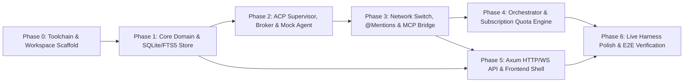

# Meta-Harness Phased Implementation Plan

This roadmap breaks the implementation of **Meta-Harness** into 7 crisp, verifiable phases (**Phase 0 -> Phase 6**). Any agent(s) picking up implementation work should complete phases in dependency order and pass every phase's **Verification Gate** before advancing.

---

## Dependency & Parallelism Map

> [!TIP]
> **Multi-Agent Parallelism**: Once **Phase 1** (`mh-core` + `mh-store` + shared wire DTOs) is merged, one agent can build **Phases 2–4** (ACP runtime, Switch MCP bridge, Orchestrator) in Rust while a second agent builds **Phase 5** (Frontend UI against a mock/stub WS server or `mh-server` skeleton) in `web/`.

---

## Phase 0: Toolchain Verification & Workspace Bootstrap

### Goals
Ensure Rust and Node toolchains compile cleanly on this machine and establish the Cargo multi-crate workspace plus Vite + React + TypeScript frontend skeleton.

### Tasks
1. **Rust Toolchain Check (Windows)**:
   - Check `cargo --version`. If absent, install `rustup` and configure `stable-x86_64-pc-windows-gnu` (self-contained linker, no 6 GB Visual Studio C++ Build Tools needed) or `stable-x86_64-pc-windows-msvc` if MSVC `cl.exe` is already installed (see `AGENTS.md` §3).
2. **Cargo Workspace Setup (`Cargo.toml`)**:
   - Initialize workspace with crates:
     - `crates/mh-core`
     - `crates/mh-store`
     - `crates/mh-acp`
     - `crates/mh-switch`
     - `crates/mh-server`
   - Pin core dependencies in `[workspace.dependencies]`: `tokio`, `axum`, `serde`, `serde_json`, `toml`, `rusqlite` (`features = ["bundled"]`), `agent-client-protocol` (`2.0`), `tracing`, `tracing-subscriber`, `uuid`, `thiserror`, `anyhow`, `which`, `dunce`, `similar` (for unified diffs).
3. **Frontend Scaffold (`web/`)**:
   - Initialize Vite + React 19 + TypeScript (`strict: true`) + Tailwind CSS v4 + Zustand + `@tanstack/react-virtual` + `lucide-react` + Vitest.
   - Configure Vite dev proxy (`/api` -> `http://127.0.0.1:4410`).

### Verification Gate
- `cargo check --workspace` and `cargo test --workspace` exit `0`.
- `cd web && npm install && npm run typecheck && npm run build` exits `0`.

---

## Phase 1: Core Domain Models, Mention Parser & SQLite/FTS5 Store (`mh-core`, `mh-store`)

### Goals
Implement pure routing/scoring primitives and the persistent SQLite + FTS5 storage and episodic memory layer.

### Tasks
1. **`crates/mh-core`**:
   - Define shared serde types: `Project`, `Session`, `HarnessProfile`, `ChatMessage`, `TurnTrajectory`, `TrajectoryEvent`, `QuotaSnapshot`, `EpisodicJob`, `ProjectFact`, `WsEvent`.
   - Implement **Code-Aware `@mention` Parser** (`mention.rs`):
     - Masks fenced code blocks and inline code spans before extracting `@handle` and optional `@handle[model:effort]` tokens.
     - Unit test edge cases: `@codex` at start/middle/end of line, `@decorator` inside Python code block (ignored), `user@example.com` (ignored), multiple `@codex @claude` targets, `@all`, `@orchestrator`.
2. **`crates/mh-store`**:
   - Implement embedded migrations applying the schema in `docs/SPECIFICATION.md` §6.3 (`WAL` mode, foreign keys).
   - CRUD repositories for `projects`, `sessions`, `session_members`, `messages` (cursor pagination + per-harness `last_seen_msg_seq` delta query), and `turn_trajectories` / `trajectory_events`.
   - **Episodic Memory Engine (`memory.rs`)**:
     - `record_job(...)` inserting into `episodic_jobs` + `episodic_jobs_fts`.
     - `recall_jobs(project_id, query, path_prefix, limit)` using FTS5 BM25 ranking + recency boost + `pinned` priority.
     - `record_fact` / `list_facts` / `delete_job`.

### Verification Gate
- Unit & integration tests in `mh-core` and `mh-store` covering mention parsing, delta message queries, trajectory pagination, and FTS5 episodic memory recall (`cargo test -p mh-core -p mh-store`).

---

## Phase 2: ACP Process Supervisor, Workspace Broker & Mock ACP Harness (`mh-acp`)

### Goals
Speak real ACP JSON-RPC 2.0 over stdio to child processes safely on Windows/Unix, broker filesystem/terminal/permission callbacks, and test everything deterministically with an offline Mock ACP Agent.

### Tasks
1. **Cross-Platform Process Supervisor (`supervisor.rs`)**:
   - Resolve executable shims via `which` (`npx.cmd`, `codex.exe`, `agy.cmd`).
   - Windows Job Object wrapper (`windows-sys` crate: `CreateJobObjectW`, `SetInformationJobObject` with `JOB_OBJECT_LIMIT_KILL_ON_JOB_CLOSE`, `AssignProcessToJobObject`) so child process trees never leak.
   - Lazy spawn on first session prompt + configurable idle reaper task.
2. **ACP Client Session Driver (`client.rs`)**:
   - Implement `agent-client-protocol` client transport over `ChildStdin` / `ChildStdout` (newline-delimited JSON-RPC 2.0) while capturing `ChildStderr` into a bounded diagnostic ring buffer.
   - Implement `initialize`, `session/new` (with `mcpServers` injection), `session/load`, `session/set_config_option` (indexing advertised `model` and `thought_level` / `reasoning_effort` options), `session/prompt`, and `session/cancel`.
   - Coalesce streaming `session/update` chunks (text deltas, thought deltas, tool call status) into structured `TrajectoryEvent` records.
3. **Workspace File/Terminal & Permission Broker (`broker.rs`)**:
   - Enforce `project_root` path sandboxing using `dunce::canonicalize`.
   - Snapshot pre-write contents on `fs/write_text_file`, compute unified diffs via `similar::TextDiff`, detect concurrent same-file writers, and record `touched_files`.
   - Handle `terminal/*` execution within `project_root` and route `session/request_permission` to an async approval channel.
4. **Deterministic Mock ACP Agent (`tests/fixtures/mock_acp_agent.rs`)**:
   - A tiny Rust test binary speaking ACP stdio that advertises `configOptions` (`model`: `mock-fast`/`mock-pro`, `reasoning_effort`: `low`/`medium`/`high`), streams thoughts + tool calls + `fs/write_text_file`, and can invoke MCP tools when instructed.

### Verification Gate
- Integration test spawns two `mock_acp_agent` instances, runs `initialize` -> `session/new` -> `session/set_config_option` -> `session/prompt`, verifies streamed trajectory diffs, permission gating, `session/cancel` latency (<250ms), and clean child termination.

---

## Phase 3: Network Switch Router & Embedded MCP Bridge (`mh-switch`, `mh-server` CLI)

### Goals
Enable multi-harness group chat routing, delta context envelopes, hop-limit loop protection, and active peer-to-peer communication + trajectory reading via `meta-harness mcp-bridge`.

### Tasks
1. **Switch Router & Hop Guard (`router.rs`)**:
   - Route incoming user messages and finalized agent replies through `mh-core` mention parser.
   - Track `chain_id` and `hops_remaining` (`max_hops` default `6`); emit `switch.hop_limit_paused` when exhausted, with resume capability (`+N` hops).
   - Construct `<group_chat_updates>` XML delta envelopes per `(session_id, harness_id)` and advance `last_seen_msg_seq` upon prompt dispatch.
   - Automatically extract and persist an `EpisodicJob` entry in `mh-store` when an executor turn completes.
2. **Embedded Switch MCP Server & Stdio Bridge (`mcp.rs` + `mcp-bridge` subcommand)**:
   - Implement `meta-harness mcp-bridge` CLI subcommand in `mh-server`: lightweight stdio JSON-RPC loop forwarding MCP `initialize`, `tools/list`, and `tools/call` to `POST /internal/mcp` authenticated with `MH_BRIDGE_TOKEN`.
   - Implement handlers for peer switch tools (`chat_list_peers`, `chat_read_messages`, `chat_send_message`, `trajectory_list`, `trajectory_read`, `memory_recall`, `memory_record_fact`) with bounded payload pagination (max 16 KB per `trajectory_read` call).

### Verification Gate
- Automated switch test: User tells `@mock-a` to write `hello.txt` and ask `@mock-b` to review its trajectory. `@mock-a` writes `hello.txt` and outputs `@mock-b please review`; Switch dispatches `@mock-b`; `@mock-b` calls `trajectory_read` via `mcp-bridge`, sees the unified diff of `hello.txt`, and replies to the group chat; `episodic_jobs` records both jobs; loop test confirms chain halts cleanly at `max_hops`.

---

## Phase 4: Orchestrator Pipeline & Subscription Quota Engine (`mh-acp::quota`, `mh-switch::orchestrator`)

### Goals
Implement unmentioned prompt orchestration with subscription usage lookup, complexity/model/effort matching, and automatic failover on quota exhaustion.

### Tasks
1. **Subscription Quota Tracker (`crates/mh-acp/src/quota.rs`)**:
   - Implement `QuotaProvider` trait with adapters for:
     - `codex_local`: inspects `~/.codex/` local session token activity + Meta-Harness turn ledger + optional cached status probe.
     - `claude_local`: inspects `~/.claude/` local project/session activity + Meta-Harness turn ledger + user-calibrated plan tier (`Pro`, `Max 5x`, `Max 20x`).
     - `google_local`: inspects `~/.gemini/` activity + Meta-Harness turn ledger + plan tier.
   - Implement reactive `429` / rate-limit error detector that marks `rate_limited_until` cooldowns immediately.
2. **Orchestrator Dispatch Pipeline (`crates/mh-switch/src/orchestrator.rs`)**:
   - Build compact `<orchestrator_telemetry>` prompt injector (live `QuotaSnapshot` table, per-harness `configOptions` models & efforts, static model strength tags from `harnesses.toml`, and top 5 FTS5 episodic memories).
   - Implement MCP tools `quota_get_status`, `models_list_catalog`, and `orchestrator_dispatch`.
   - Validate `orchestrator_dispatch` calls -> emit `dispatch_card` message to group chat -> apply `session/set_config_option` (`model` + `reasoning_effort`) on target executor -> execute executor turn (supporting sequential chains and read-only parallel fan-out).
   - Add deterministic fallback heuristic if the Orchestrator harness itself hits a rate limit!

### Verification Gate
- Integration test verifying:
  1. Unmentioned prompt routes to Orchestrator, which calls `orchestrator_dispatch` selecting `mock-pro` + `high` effort for a complex architecture prompt vs `mock-fast` + `low` effort for a typo fix.
  2. When `@mock-a`'s simulated 5h quota is set to `5%` (or `429`), Orchestrator selects `@mock-b` (`88%` remaining) and surfaces the quota rationale in the `dispatch_card`.

---

## Phase 5: Axum Server & Responsive Group-Chat Web UI (`mh-server`, `web/`)

### Goals
Deliver a fast, low-memory HTTP + multiplexed WebSocket backend and a polished, keyboard-friendly group chat UI.

### Tasks
1. **`crates/mh-server`**:
   - Implement REST endpoints and `/api/ws` multiplexed WebSocket hub (`docs/SPECIFICATION.md` §7) with 25ms stream chunk coalescing and selective trajectory subscription.
   - Serve compiled `web/dist` static assets (`tower-http` / `rust-embed`) so production runs as a single self-contained binary on `http://127.0.0.1:4410`.
2. **`web/` Frontend**:
   - **Left Sidebar**: Project folder switcher/browser, session list, Harness Roster with status badges, Orchestrator crown selector, and 5h/Weekly quota bars.
   - **Center Group Chat**:
     - `@tanstack/react-virtual` message list with memoized Markdown + syntax highlighting.
     - Orchestrator Dispatch Cards, Trajectory Summary Pills (`Inspect ->`), Hop Limit Pause banner, and inline Permission Approval Cards (`Alt+A` / `Alt+R`).
     - Smart Composer with `@mention` popup (including optional `[model:effort]` selector), `#file` path completions, live routing target preview, and `Stop All` button.
   - **Right Drawer**:
     - **Trajectory Inspector**: Live thoughts, tool calls, terminal runs, and unified file diffs.
     - **Memory Ledger**: Searchable high-level jobs ("Who did what") + pinned project facts.
     - **Switch & Quotas Settings**: Plan tier calibration, custom harness command config, hop budget slider.

### Verification Gate
- `npm run typecheck && npm run test && npm run build` pass.
- End-to-end UI test (or Playwright/Vitest suite) verifying project creation, `@mention` autocomplete, streaming chat rendering without dropped frames, trajectory drawer inspection, permission approval, and memory ledger editing.

---

## Phase 6: Live Harness Integration, Resource Tuning & Hardening

### Goals
Validate real-world compatibility with installed CLI harnesses on Windows (`@agentclientprotocol/codex-acp`, `@agentclientprotocol/claude-agent-acp`, `agy --acp` / `gemini --acp`) and verify memory/CPU budgets.

### Tasks
1. **Harness Doctor & Onboarding Probe (`GET /api/harnesses/probe`)**:
   - Detect which CLIs (`codex`, `claude`, `agy`, `gemini`, `npx`) are installed and signed in on the user's PC, surfacing one-click setup hints in the UI for any uninstalled adapter (never blocking installed ones).
2. **Real-World Adapter Quirk Handling**:
   - Test `codex-acp` on this machine (Codex CLI is already installed at `C:\Users\panzh\AppData\Local\Programs\OpenAI\Codex\bin\codex.exe` and Node v24 is available) to verify `configOptions` IDs for model & reasoning effort, Windows path formatting, and `mcp-bridge` tool calls.
   - Verify graceful error cards when an adapter is missing authentication (`codex login`, `claude login`, `agy`).
3. **Resource & Performance Audit**:
   - Confirm `meta-harness.exe` idle RSS < 30 MB, SQLite WAL checkpointing works cleanly, idle harness subprocesses hibernate on schedule, and shutting down `meta-harness` leaves zero orphan subprocesses in Windows Task Manager.

### Verification Gate
- Full `cargo clippy --workspace -- -D warnings`, `cargo test --workspace`, `npm run build`, plus live smoke test running a session on a sample folder with real ACP adapter(s).
