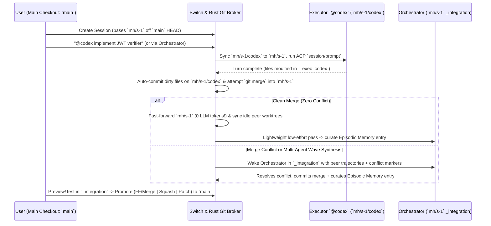

# Meta-Harness Technical Specification

## 1. System Overview

**Meta-Harness** is a local-first web application that coordinates multiple AI coding harnesses (**Codex**, **Claude Code**, **Antigravity / Gemini CLI**, and custom ACP-compliant agents/personas) inside **project-scoped group chat sessions**.

Meta-Harness combines four architectural layers inside a single low-footprint Rust binary + virtualized React SPA:
1. **Isolated Git Worktree Fabric**: Every session maintains a clean **Session Integration Branch/Worktree** (`mh/s-<id>`) plus **per-executor Git worktrees** (`mh/s-<id>/<member>`), allowing multiple harnesses to execute genuinely **in parallel** without clobbering each other or touching the user's main checkout until promoted.
2. **ACP Client Hub**: Speaks JSON-RPC 2.0 over stdio (`agent-client-protocol`) to locally installed CLI harnesses, inheriting the user's existing AI subscriptions (`~/.codex`, `~/.claude`, `~/.gemini`).
3. **L2/L3 Agent Network Switch**: Connects all session members via an injected single-binary MCP bridge (`meta-harness mcp-bridge`), enabling async `@mention` handoffs, synchronous deadlock-checked mid-turn `peer_consult` calls, and live cross-harness `trajectory_read` inspection.
4. **Quota-Aware Orchestrator & Curated Memory Plane**: Routes unmentioned prompts by evaluating subscription quota headroom, task complexity, model characteristics, and project memory; resolves cross-worktree merge conflicts; and curates high-level episodic memory (`SQLite + FTS5`) after each completed job.

```mermaid
flowchart TB
    subgraph Browser["Web Frontend (127.0.0.1 Default / Optional Token LAN)"]
        ChatUI["Group Chat, Collapsible Consults & @Mention Composer"]
        GitBar["Session Changes Bar, Preview Launcher & 3-Mode Promote"]
        Drawer["Trajectory Inspector, Curated Memory & Quota Settings"]
    end

    subgraph Backend["Rust Backend (`meta-harness` single binary)"]
        WS["Axum REST + WS Hub (+ Optional Bearer Auth)"]
        Switch["Switch Router (Parallel Queue, Hop Guard, Wait-For DAG)"]
        Orch["Orchestrator Pipeline, Memory Curator & Quota Engine"]
        GitBroker["Git Worktree Broker (Zero-Token Clean Merge & Sync)"]
        Mem["Episodic Memory Store (SQLite WAL + FTS5)"]
        ACPSup["ACP Process Supervisor & Worktree-Smart Permission Broker"]
    end

    subgraph Worktrees["Isolated Session Git Worktrees"]
        WTInt["`_integration` (`mh/s-1a2b`)\nOrchestrator CWD"]
        WTCodex["`_exec_codex` (`mh/s-1a2b/codex`)"]
        WTClaude["`_exec_claude` (`mh/s-1a2b/claude`)"]
    end

    Browser <-->|"HTTP + WS JSON"| WS
    WS <--> Switch
    Switch <--> Orch
    Switch <--> GitBroker
    Switch <--> Mem
    Switch <--> ACPSup
    ACPSup <-->|"ACP stdio + `mcp-bridge`"| WTInt & WTCodex & WTClaude
    GitBroker -->|"Auto-merge / Conflict Escalate"| WTInt
    WTCodex & WTClaude -.->|"Clean Merge / Rebase"| GitBroker
```

---

## 2. Core Domain Model: Adapters, Members & Worktrees

### 2.1 `HarnessAdapter` vs. `SessionMember`
To allow the **Orchestrator's harness brand to also execute coding tasks** (and let users create custom personas like `@codex-reviewer` even with a single subscription), Meta-Harness decouples adapters from group-chat participants:

- **`HarnessAdapter`** (`adapter_id`: `"codex"`, `"claude"`, `"antigravity"`, or custom):
  - Defines the underlying ACP command/args, discovered `configOptions` (`models`, `reasoning_efforts`), static capability tags, and **shared Subscription Quota Bucket**.
- **`SessionMember`** (`handle`: `"codex"`, `"claude"`, `"codex-reviewer"`, etc.):
  - Belongs to a `Session`, references an `adapter_id`, holds an optional `persona_prompt`, `role` (`orchestrator` | `executor`), its own ACP `sessionId`, `last_seen_msg_seq`, and its own Git worktree path!
  - *Example*: If the user sets `@claude` as the Session's **Orchestrator**, Meta-Harness maintains an orchestrator context in `_integration` **and** allows `orchestrator_dispatch(target = "claude", ...)` to run coding work in `_exec_claude`, accounting both turns against the `claude` adapter's quota snapshot.

### 2.2 Git Worktree Lifecycle & Integration Flow (`mh-acp::worktree`)



1. **Non-Git Directory Onboarding**:
   - When opening a folder without `.git`, the UI prompts: **[Initialize Git Repository (Recommended)]** (runs `git init -b main` + initial commit so full worktree isolation works) or **[Use Shared Folder Mode]** (disables parallel writes and enables per-file write locks).
2. **Worktree Storage Layout**:
   - Stored under `<project_root>/.meta-harness/worktrees/<session_id>/` (automatically excluded via `.git/info/exclude` so `.gitignore` in the user's repo stays clean without polluting `git status`!).
   - `_integration` checks out `mh/s-<short_id>`.
   - `_exec_<handle>` checks out `mh/s-<short_id>/<handle>` (created lazily when that member first executes).
3. **Promotion Modes to User's Main Checkout**:
   - **Fast-Forward / Merge Commit**: Merges `mh/s-<short_id>` into `<base_branch>` (auto-stashing and restoring uncommitted user edits if requested, or warning cleanly if dirty).
   - **Squash Merge**: Collapses session commits into a single clean commit on `<base_branch>`.
   - **Apply Patch**: Applies `git diff <base_sha>..mh/s-<short_id>` onto the user's main working tree without creating commits, letting the user review/stage manually.
   - **Preview / Dev Shell Helper**: Launches a terminal or user command (`npm run dev`, `cargo test`) directly inside `_integration` so integrated agent work can be verified live before touching the main checkout.

---

## 3. ACP Client Lifecycle & Worktree-Smart Permissions (`mh-acp`)

### 3.1 Lazy Spawning, Hibernation & Cross-Platform Process Supervision
1. Subprocesses spawn lazily on first turn in a session, inheriting OS user environment (`USERPROFILE`/`HOME`, `APPDATA`/`XDG_CONFIG_HOME`, `LOCALAPPDATA`/`XDG_DATA_HOME`, `PATH`) to reuse existing CLI subscriptions on Windows, macOS, and Linux.
2. Process tree cleanup is enforced natively on every OS: Win32 Job Objects (`JOB_OBJECT_LIMIT_KILL_ON_JOB_CLOSE`) on Windows, dedicated process groups (`process_group(0)` + `killpg(SIGTERM -> SIGKILL)`) on macOS & Linux, and `prctl(PR_SET_PDEATHSIG, SIGTERM)` on Linux.
3. Config and data directories follow native platform conventions (`%APPDATA%`/`%LOCALAPPDATA%` on Windows, `~/Library/Application Support` on macOS, `$XDG_CONFIG_HOME`/`$XDG_DATA_HOME` on Linux, overridable via `MH_CONFIG_DIR`/`MH_DATA_DIR`).
4. Processes idle beyond `idle_process_ttl_secs` (`900s`) hibernate and transparently resume via ACP `session/load` (if advertised) or `session/new` seeded with the session's compact working summary + last worktree state.

### 3.2 ACP Handshake, MCP Injection & `session/set_config_option`
1. **`initialize`** -> negotiates `fs` (`readTextFile`, `writeTextFile`) and `terminal` capabilities.
2. **`session/new`** -> sets `cwd` to the member's assigned worktree (`_integration` for orchestrator turns, `_exec_<handle>` for executor turns) and injects `meta-harness-switch` into `mcpServers`:
   ```json
   {
     "cwd": "C:/Users/panzh/project/.meta-harness/worktrees/s_01/_exec_codex",
     "mcpServers": [
       {
         "name": "meta-harness-switch",
         "command": "C:/path/to/meta-harness.exe",
         "args": ["mcp-bridge", "--url", "http://127.0.0.1:4410/internal/mcp", "--session", "s_01", "--caller", "codex"],
         "env": [{ "name": "MH_BRIDGE_TOKEN", "value": "<ephemeral_hmac_token>" }]
       }
     ]
   }
   ```
3. **`configOptions` & `session/set_config_option`**:
   - Indexes advertised `model` and `thought_level` / `reasoning_effort` selectors from `session/new`.
   - Applies target `model` and `reasoning_effort` via `session/set_config_option` prior to `session/prompt`.

### 3.3 Worktree-Smart Permission Policy (`default = "worktree_smart"`)
- **Auto-Allowed**: `fs/read_text_file` inside the project/worktrees and `fs/write_text_file` strictly **inside the calling member's own isolated Git worktree** (evaluated after `dunce::canonicalize` containment check).
- **Prompt in Group Chat**:
  - Any `terminal/*` shell command execution (with 1-click **"Allow command prefix for session"**, e.g., `cargo test*`, `npm run build`, stored in `session_permission_rules`).
  - Any file read/write outside the member's worktree.
- **Alternative Modes**: `strict` (prompt on file writes too) and `autonomous_sandbox` (auto-allow non-destructive local dev commands inside worktree, prompt only on external paths or `git push`/`rm` outside worktree).

---

## 4. Network Switch, Parallel Routing & Inter-Harness Tools (`mh-switch`)

### 4.1 Mention Routing & Delta Context Envelopes
1. Strips fenced code blocks and inline code spans before matching `@<handle>` (plus optional `@<handle>[<model>:<effort>]`, `@all`, `@orchestrator`).
2. Multiple mentioned executors (`@codex @claude`) dispatch **in parallel** in their isolated worktrees!
3. Each `session/prompt` prepends only unseen group-chat messages (`seq > member.last_seen_msg_seq`) in `<group_chat_updates>` XML so stateful ACP sessions never waste tokens re-reading prior messages.

### 4.2 Synchronous `peer_consult` & Deadlock Detection
In addition to async group-chat handoffs (`chat_send_message`), an active harness mid-turn can call `peer_consult(target, question, context_turn_id?)`:
1. **Wait-For DAG Check**: `SwitchState` maintains directed edges `caller -> target` for all in-flight `peer_consult` RPCs. If adding `caller -> target` creates a cycle (e.g., `@claude` consults `@codex` while `@codex` is directly or transitively waiting on `@claude`), `mh-switch` immediately rejects the tool call with a descriptive guidance string (`"Cycle detected: @codex is currently waiting on @claude; post an async @codex message via chat_send_message instead"`).
2. **Hop & Timeout Guard**: Consumes 1 hop from `chain.hops_remaining` and enforces `peer_consult_timeout_secs` (default `180s`).
3. **Execution & Chat Visibility**: If `target` is idle (or once its current non-dependent turn finishes), runs a focused consult prompt on `target` and returns the answer synchronously as the MCP tool result to `caller`, while rendering a **Collapsible Consult Thread** in the main Group Chat UI.

### 4.3 Switch MCP Tools Summary

| Tool Name | Caller | Description & UI Visibility |
| :--- | :--- | :--- |
| `chat_list_peers` | All | Lists session members, adapter brands, roles, live states (`idle`/`working`/`consulting`), active models, and worktree branches. |
| `chat_read_messages` | All | Paginated read of group chat messages (`limit`, `before_seq`). |
| `chat_send_message` | All | Posts a visible message/handoff to Group Chat and triggers `@to` recipients asynchronously (consumes 1 hop). |
| `peer_consult` | All | Synchronous mid-turn question to a peer with DAG deadlock prevention; renders as a compact collapsible thread in Group Chat (consumes 1 hop). |
| `trajectory_list` | All | Lists recent turns (`turn_id`, `member`, `summary`, `touched_files`, `git_diff_stat`, `status`). |
| `trajectory_read` | All | Reads a peer's trajectory (`summary` \| `tool_calls` \| `diffs` \| `full`, max 16 KB/page); emits a subtle inline pill in Group Chat (`@claude read @codex's trajectory`). |
| `memory_recall` | All | Queries project-wide `episodic_jobs` + `project_facts` via SQLite FTS5. |
| `memory_record_fact` | All | Records or updates a high-level architectural/ownership/performance note (`project_facts`). |
| `quota_get_status` | All / Orch | Returns adapter-level subscription quota headroom snapshots. |
| `models_list_catalog` | Orchestrator | Returns live ACP `configOptions` (`models`, `efforts`) + adapter capability metadata. |
| `orchestrator_dispatch` | Orchestrator | Configures target executor member(s) (`model`, `reasoning_effort`) and dispatches 1 or more parallel/sequential worktree tasks with a visible Dispatch Card. |
| `memory_curate_job` | Orchestrator | Saves the curated post-job `EpisodicJob` summary + optional `project_facts` updates after a turn/wave completes. |

---

## 5. Orchestrator Pipeline & Subscription Quota Engine

### 5.1 Layered Subscription Usage Tracker (`mh-acp::quota`)
Tracked per `HarnessAdapter` (so multiple personas of the same CLI share one quota pool):
1. **Default Live Provider Quota APIs (`exact_quota_probe_opt_in = true`)**:
   - **Codex (`codex_local`)**: Queries `codex app-server --stdio` (`account/rateLimits/read`) via JSON-RPC, falling back to `GET https://chatgpt.com/backend-api/wham/usage` with local OAuth credentials from `~/.codex/auth.json`. Surfaces exact plan tier (`ProLite`, `Plus`, `Pro`, `Team`), 5h/weekly windows, and reset timestamps with a 5-minute TTL cache (plus post-turn invalidation & manual `POST /api/quotas/refresh`).
   - **Claude Code (`claude_local`)**: Reads OAuth credentials from `~/.claude/.credentials.json` (or macOS Keychain) and queries `GET https://api.anthropic.com/api/oauth/usage` with 5-minute caching (10-minute backoff on HTTP 429).
   - **Google / Antigravity (`google_local`)**: Verifies API keys via Generative Language API or reports local account connection status honestly (`QuotaSource::Unavailable` rather than fabricating `100%` when no public OAuth percentage API exists).
   - **Reactive `429` Circuit Breaker**: Immediately marks `rate_limited_until` upon rate-limit errors and triggers automatic Orchestrator failover.
2. **Manual Calibration & Offline Mode**:
   - Users can disable live probes (`exact_probe_opt_in = false`) or supply manual calibration percentages; offline integration tests use deterministic `quota_provider = "manual"` accounting.

### 5.2 Orchestrator Decision Modes & Self-Brand Dispatch
When an unmentioned user prompt arrives:
1. `mh-switch` injects `<orchestrator_telemetry>` (~200 tokens: adapter quota percentages, available `(model, effort)` options, and top 5 FTS5 episodic memories).
2. **Pragmatic Execution Rules**:
   - **Trivial Question / Quick Repo Inspection / Branch Merge**: Orchestrator answers directly from `_integration` without wasting an extra hop.
   - **Single or Decomposable Coding Work**: Calls `orchestrator_dispatch(...)` to assign work to one or more executor members (including an executor worktree of its own adapter brand if best suited!), selecting:
     - `low` effort + fast model for simple edits/boilerplate.
     - `medium` effort + domain-matched model for standard features/UI/tests.
     - `high` / `xhigh` effort + flagship model for hard systems/architecture/concurrency tasks—automatically shifting to a peer adapter when remaining 5h quota drops below threshold (`<15%`).
   - **Confirm-Plan Mode (Optional Session Toggle)**: Posts the proposed Dispatch Card in `"awaiting_confirmation"` state until the user clicks **Proceed** (or edits model/target inline).

---

## 6. Curated Episodic Memory & SQLite Schema (`mh-store`)

### 6.1 Orchestrator LLM Memory Curation Pass
To keep memory high-signal without low-level clutter:
1. Whenever an executor job (or parallel wave) finishes and merges into `_integration`:
   - **Piggyback Optimization**: If the Orchestrator is *already* running a conflict-resolution or wave-synthesis turn, `mh-switch` instructs it in that same turn to invoke `memory_curate_job(...)`.
   - **Standalone Lightweight Pass**: If the Rust Git Broker merged cleanly with zero conflicts, `mh-switch` triggers a fast, `low`-effort background curation prompt on the Orchestrator with `(task_brief, git diff --stat, executor final reply)` (<600 input tokens) to produce a crisp 1–2 sentence `EpisodicJob` entry + any durable `ProjectFact` (e.g., module ownership or `"@codex resolved async lifetime issues in mh-acp cleanly"`).
   - *(Fallback: If a session has no Orchestrator configured, `mh-switch` records deterministic job metadata directly.)*

### 6.2 SQLite + FTS5 Schema (`WAL` Mode)

```sql
PRAGMA journal_mode = WAL;
PRAGMA synchronous = NORMAL;
PRAGMA foreign_keys = ON;

CREATE TABLE projects (
    id              TEXT PRIMARY KEY,
    name            TEXT NOT NULL,
    root_path       TEXT NOT NULL UNIQUE,
    is_git_repo     INTEGER NOT NULL DEFAULT 1,
    created_at      INTEGER NOT NULL,
    last_opened_at  INTEGER NOT NULL
);

CREATE TABLE sessions (
    id                      TEXT PRIMARY KEY,
    project_id              TEXT NOT NULL REFERENCES projects(id) ON DELETE CASCADE,
    title                   TEXT NOT NULL,
    base_branch             TEXT,
    base_commit_sha         TEXT,
    integration_branch      TEXT,          -- e.g. 'mh/s-8f3a'
    integration_wt_path     TEXT,
    isolation_mode          TEXT NOT NULL DEFAULT 'worktree_per_member', -- or 'shared_cwd'
    orchestrator_member     TEXT,          -- references session_members.handle
    confirm_before_dispatch INTEGER NOT NULL DEFAULT 0,
    max_hops                INTEGER NOT NULL DEFAULT 6,
    permission_policy       TEXT NOT NULL DEFAULT 'worktree_smart',
    working_summary         TEXT NOT NULL DEFAULT '',
    created_at              INTEGER NOT NULL,
    updated_at              INTEGER NOT NULL
);

CREATE TABLE session_members (
    session_id          TEXT NOT NULL REFERENCES sessions(id) ON DELETE CASCADE,
    handle              TEXT NOT NULL,     -- e.g. 'codex', 'claude', 'codex-reviewer'
    adapter_id          TEXT NOT NULL,     -- e.g. 'codex', 'claude', 'antigravity'
    display_name        TEXT NOT NULL,
    role                TEXT NOT NULL DEFAULT 'executor', -- 'orchestrator' | 'executor' | 'both'
    persona_prompt      TEXT NOT NULL DEFAULT '',
    worktree_branch     TEXT,
    worktree_path       TEXT,
    acp_session_id      TEXT,
    active_model        TEXT,
    active_effort       TEXT,
    last_seen_msg_seq   INTEGER NOT NULL DEFAULT 0,
    PRIMARY KEY (session_id, handle)
);

CREATE TABLE session_permission_rules (
    id              TEXT PRIMARY KEY,
    session_id      TEXT NOT NULL REFERENCES sessions(id) ON DELETE CASCADE,
    tool_kind       TEXT NOT NULL,         -- 'terminal' | 'fs_external'
    pattern         TEXT NOT NULL,         -- e.g. 'cargo test*'
    decision        TEXT NOT NULL,         -- 'allow' | 'deny'
    created_at      INTEGER NOT NULL
);

CREATE TABLE messages (
    seq             INTEGER PRIMARY KEY AUTOINCREMENT,
    id              TEXT NOT NULL UNIQUE,
    session_id      TEXT NOT NULL REFERENCES sessions(id) ON DELETE CASCADE,
    chain_id        TEXT NOT NULL,
    parent_msg_id   TEXT,                  -- links peer_consult replies into a collapsible thread
    sender_kind     TEXT NOT NULL,         -- 'user' | 'member' | 'orchestrator' | 'system'
    sender_id       TEXT NOT NULL,
    recipients_json TEXT NOT NULL DEFAULT '[]',
    kind            TEXT NOT NULL,         -- 'text' | 'dispatch_card' | 'consult_thread' | 'activity_pill' | 'permission_card' | 'merge_notice'
    content         TEXT NOT NULL,
    turn_id         TEXT,
    metadata_json   TEXT NOT NULL DEFAULT '{}',
    created_at      INTEGER NOT NULL
);
CREATE INDEX idx_messages_session_seq ON messages(session_id, seq);

CREATE TABLE turn_trajectories (
    turn_id         TEXT PRIMARY KEY,
    session_id      TEXT NOT NULL REFERENCES sessions(id) ON DELETE CASCADE,
    member_handle   TEXT NOT NULL,
    adapter_id      TEXT NOT NULL,
    model           TEXT,
    effort          TEXT,
    worktree_branch TEXT,
    head_commit_sha TEXT,
    status          TEXT NOT NULL,         -- 'running' | 'completed' | 'cancelled' | 'failed'
    summary         TEXT NOT NULL DEFAULT '',
    touched_files   TEXT NOT NULL DEFAULT '[]',
    diff_stat_json  TEXT NOT NULL DEFAULT '{}',
    started_at      INTEGER NOT NULL,
    finished_at     INTEGER
);

CREATE TABLE trajectory_events (
    id              INTEGER PRIMARY KEY AUTOINCREMENT,
    turn_id         TEXT NOT NULL REFERENCES turn_trajectories(turn_id) ON DELETE CASCADE,
    event_kind      TEXT NOT NULL,         -- 'thought' | 'plan' | 'tool_call' | 'diff' | 'terminal' | 'error'
    payload_json    TEXT NOT NULL,
    created_at      INTEGER NOT NULL
);
CREATE INDEX idx_traj_events_turn ON trajectory_events(turn_id, id);

CREATE TABLE episodic_jobs (
    id              TEXT PRIMARY KEY,
    project_id      TEXT NOT NULL REFERENCES projects(id) ON DELETE CASCADE,
    session_id      TEXT REFERENCES sessions(id) ON DELETE SET NULL,
    turn_id         TEXT,
    member_handle   TEXT NOT NULL,
    adapter_id      TEXT NOT NULL,
    model           TEXT,
    effort          TEXT,
    task_brief      TEXT NOT NULL,
    curated_summary TEXT NOT NULL,
    touched_modules TEXT NOT NULL DEFAULT '[]',
    outcome         TEXT NOT NULL,
    curated_by      TEXT NOT NULL DEFAULT 'orchestrator',
    pinned          INTEGER NOT NULL DEFAULT 0,
    created_at      INTEGER NOT NULL
);

CREATE VIRTUAL TABLE episodic_jobs_fts USING fts5(
    job_id UNINDEXED,
    project_id UNINDEXED,
    member_handle,
    adapter_id,
    task_brief,
    curated_summary,
    touched_modules
);

CREATE TABLE project_facts (
    id              TEXT PRIMARY KEY,
    project_id      TEXT NOT NULL REFERENCES projects(id) ON DELETE CASCADE,
    category        TEXT NOT NULL,         -- 'architecture' | 'ownership' | 'harness_affinity' | 'convention'
    summary         TEXT NOT NULL,
    author_id       TEXT NOT NULL,
    created_at      INTEGER NOT NULL
);
```

---

## 7. Server, Auth & Frontend UX Specification

### 7.1 Localhost Default + Optional LAN/Tailscale Bearer Mode (`mh-server`)
- **Default**: Binds `127.0.0.1:4410` with zero login friction and opens the system browser automatically.
- **Remote / LAN / Tailscale Mode** (`meta-harness serve --bind 0.0.0.0:4410`):
  - Automatically enforces Bearer/Cookie authentication using a cryptographically random access token printed to the terminal (plus a convenient pairing URL `http://<lan-or-tailscale-ip>:4410/?token=...` that exchanges for an `HttpOnly; SameSite=Strict` session cookie).

### 7.2 REST & Multiplexed WebSocket API
- **Projects & Git Onboarding**: `GET/POST/DELETE /api/projects`, `POST /api/projects/:id/git-init`, `GET /api/fs/list`, `POST /api/fs/pick-folder` (localhost native OS folder chooser on Windows/macOS/Linux).
- **Sessions & Personas**: `GET/POST /api/projects/:id/sessions`, `GET/PATCH/DELETE /api/sessions/:id`, `POST/PATCH/DELETE /api/sessions/:id/members` (add/configure `@codex-reviewer` personas, assign Orchestrator).
- **Session Git Integration & Promotion**:
  - `GET /api/sessions/:id/diff` — Cumulative diff of `integration_branch` vs `base_branch` + per-member unmerged status.
  - `POST /api/sessions/:id/preview-terminal` — Spawns/attaches a test command or opens a shell rooted in `_integration`.
  - `POST /api/sessions/:id/promote` — Promotes session branch to main checkout (`mode`: `"merge"` | `"squash"` | `"patch"`).
- **Chat, Permissions & Cancellation**:
  - `GET/POST /api/sessions/:id/messages`, `POST /api/sessions/:id/cancel` (Stop All <250ms), `POST /api/sessions/:id/permissions/:req_id` (`allow_once` | `allow_pattern_session` | `reject`).
- **Trajectories, Memory & Quotas**:
  - `GET /api/trajectories/:turn_id`, `GET/POST/PATCH/DELETE /api/projects/:id/memory/*`, `GET /api/adapters`, `GET /api/quotas`, `POST /api/quotas/refresh`, `PATCH /api/adapters/:id/quota`.
- **WebSocket (`/api/ws?session_id=...`)**: Streams 25ms-coalesced deltas for parallel active turns (`chat.*`, `switch.dispatch_decided`, `switch.consult_updated`, `switch.activity_pill`, `git.branch_updated`, `git.conflict_escalated`, `permission.requested`, `quota.updated`, `memory.job_curated`).

### 7.3 Three-Column Responsive UI Layout (`web/`)
Supports four selectable themes (`Obsidian Studio`, `Tokyo Night`, `Catppuccin Mocha`, `Paper Daylight`) persisted in `localStorage`:
1. **Collapsible Left Rail (`Ctrl+B`)**:
   - Custom project dropdown & dual folder open (localhost native OS chooser + in-app directory browser supporting `~` & quoted paths), Session list, and **Member Roster** (`@codex`, `@claude`, `@antigravity`, `+ Add Persona`) showing `HarnessAvatar` status indicators, plan badges, Orchestrator crown toggle, and shared adapter **Live Quota Windows + Reset Countdowns**.
2. **Center Canvas**:
   - **Welcome Studio Dashboard**: Primary Open Project Folder CTA, recent projects grid, and live connected harness quota cards.
   - **Top Session Changes Bar**: Shows `mh/<sid>/integration` ahead of `main` (`+142 / -31 · 5 files`), **[Diff]** (`DiffViewer` per-file +/- view), **[Preview / Shell]**, and **[Promote ▾]** (`Fast-Forward / Merge`, `Squash Merge`, `Apply Uncommitted Patch`).
   - **Developer Thread Group Chat Stream**:
     - Full-width aligned message rows with harness avatars, rich Markdown rendering (headings, lists, pipe tables, copyable code/diff blocks), **Orchestrator Dispatch Cards**, **Collapsible `peer_consult` Threads**, subtle **Trajectory Read Pills**, **Git Clean-Merge / Conflict Notices**, and **Worktree-Smart Permission Cards**.
   - **Keyboard-Navigable `@mention` Composer**: Auto-resizing input autocompleting `@member` with live quota % badges, `@all`, `@orchestrator`, and `Confirm Plan First` pill toggle.
3. **Right Inspector Drawer**:
   - **Trajectory**: Step-by-step thoughts, tool calls, terminal logs, and `DiffViewer` file patches for any selected turn.
   - **Memory Ledger**: Orchestrator-curated job history & pinned architectural/affinity facts.
   - **Switch & Quotas**: Live API quota refresh, plan tier selection, `Live API` probe toggles, segmented permission mode cards, and session rules.
