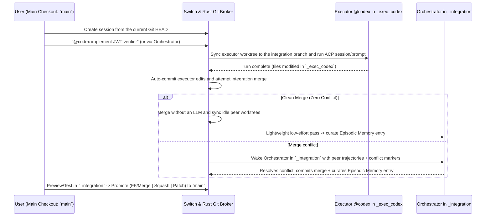

# Meta-Harness Technical Specification

## 1. System Overview

**Meta-Harness** coordinates Codex, Claude Code, Antigravity / Gemini CLI, and custom ACP harnesses in project group chats and standalone Quick Sessions. The same React frontend runs in a browser or in the Electron desktop app.

Meta-Harness combines four architectural layers inside a single low-footprint Rust binary + virtualized React SPA:
1. **Git worktree isolation.** Git-backed sessions combine `mh/<session_id>/integration` with per-executor branches at `mh/<session_id>/exec-<handle>`. Harnesses can work in parallel while the original checkout stays separate until promotion. Shared-folder sessions serialize their turns.
2. **ACP client.** The supervisor speaks JSON-RPC 2.0 over stdio to local CLI harnesses. Each adapter uses the ordinary CLI profile or a separate profile.
3. **Session switch.** The embedded MCP bridge (`meta-harness mcp-bridge`) supports asynchronous handoffs, cycle-checked synchronous consults, and trajectory inspection.
4. **Orchestrator and project memory.** The orchestrator receives quota, model, and memory context for routing decisions, handles merge conflicts, and can curate job summaries in SQLite with FTS5.

```mermaid
flowchart TB
    subgraph Browser["Web Frontend (127.0.0.1 Default / Optional Token LAN)"]
        ChatUI["Group Chat, Collapsible Consults & @Mention Composer"]
        GitBar["Session Header, Diff Review, Terminal & Promote"]
        Drawer["Turn Activity, Project Memory & Settings"]
    end

    subgraph Backend["Rust Backend (`meta-harness` single binary)"]
        WS["Axum REST + WS Hub (+ Optional Bearer Auth)"]
        Switch["Switch Router (Parallel Queue, Hop Guard, Wait-For DAG)"]
        Orch["Orchestrator Pipeline, Memory Curator & Quota Engine"]
        GitBroker["Git Worktree Broker (Zero-Token Clean Merge & Sync)"]
        Mem["Episodic Memory Store (SQLite WAL + FTS5)"]
        ACPSup["ACP Process Supervisor & Worktree-Smart Permission Broker"]
    end

    subgraph Worktrees["Isolated Session Git Worktrees"]
        WTInt["`_integration` (`mh/s_1a2b/integration`)\nOrchestrator CWD"]
        WTCodex["`_exec_codex` (`mh/s_1a2b/exec-codex`)"]
        WTClaude["`_exec_claude` (`mh/s_1a2b/exec-claude`)"]
    end

    Browser <-->|"HTTP + WS JSON"| WS
    WS <--> Switch
    Switch <--> Orch
    Switch <--> GitBroker
    Switch <--> Mem
    Switch <--> ACPSup
    ACPSup <-->|"ACP stdio + `mcp-bridge`"| WTInt & WTCodex & WTClaude
    GitBroker -->|"Auto-merge / Conflict Escalate"| WTInt
    WTCodex & WTClaude -.->|"Clean Merge / Rebase"| GitBroker
```

---

## 2. Core Domain Model: Adapters, Members & Worktrees

### 2.1 `HarnessAdapter` vs. `SessionMember`
To allow the **Orchestrator's harness brand to also execute coding tasks** (and let users create custom personas like `@codex-reviewer` even with a single subscription), Meta-Harness decouples adapters from group-chat participants:

- **`HarnessAdapter`** (`adapter_id`: `"codex"`, `"claude"`, `"antigravity"`, or custom):
  - Defines the underlying ACP command/args, discovered `configOptions` (`models`, `reasoning_efforts`), static capability tags, and **shared Subscription Quota Bucket**.
- **`SessionMember`** (`handle`: `"codex"`, `"claude"`, `"codex-reviewer"`, etc.):
  - Belongs to a session and references an adapter. It stores a persona prompt, a role (`orchestrator`, `executor`, or `both`), model and effort settings, a profile-scoped ACP session ID, and `last_seen_msg_seq`.
  - *Example*: If the user sets `@claude` as the Session's **Orchestrator**, Meta-Harness maintains an orchestrator context in `_integration` **and** allows `orchestrator_dispatch(target = "claude", ...)` to run coding work in `_exec_claude`, accounting both turns against the `claude` adapter's quota snapshot.
- **Global persona** stores a reusable handle, adapter, display name, instructions, model, and effort. Session creation or **Add to session** copies these settings into a separate session member.

### 2.2 Git Worktree Lifecycle & Integration Flow (`mh-acp::worktree`)



1. **Workspace selection.** The folder picker can initialize a non-Git project. Shared-folder sessions serialize turns with a session-wide lock. Quick Sessions allocate a managed folder at `~/.meta-harness/workspaces/<session_id>` by default and try to initialize Git there.
2. **Worktree layout.** Checkouts live under `<repo_root>/.meta-harness/worktrees/<session_id>/`, excluded from Git through `.git/info/exclude`. The `_integration` checkout tracks `mh/<session_id>/integration`. The `_exec_<handle>` checkouts track `mh/<session_id>/exec-<handle>` and are created on demand.
3. **Promotion.** Merge, squash, and unstaged patch promotion use the recorded base branch and require a clean project checkout. Commit-based promotion updates the session baseline and integration worktree. Promotion holds the same integration lock as automatic merges. Quick Sessions have their own Git history.
4. **Archive and restore.** Archiving checkpoints the worktrees and removes their checkouts while retaining session data and branches. Restoring recreates the integration checkout as needed. Deleting a session prunes its worktrees and branches.

---

## 3. ACP Client Lifecycle & Worktree-Smart Permissions (`mh-acp`)

### 3.1 Lazy Spawning, Hibernation & Cross-Platform Process Supervision
1. Subprocesses spawn lazily on first turn in a session, inheriting OS user environment (`USERPROFILE`/`HOME`, `APPDATA`/`XDG_CONFIG_HOME`, `LOCALAPPDATA`/`XDG_DATA_HOME`, `PATH`) to reuse existing CLI subscriptions on Windows, macOS, and Linux.
   - The default Codex launcher prefers an installed `codex-acp` or a matching entry in the local npm exec cache. A fresh setup falls back to `npx --prefer-offline`. Custom launch commands and version pins follow their configured path.
2. Process tree cleanup is enforced natively on every OS: Win32 Job Objects (`JOB_OBJECT_LIMIT_KILL_ON_JOB_CLOSE`) on Windows, dedicated process groups (`process_group(0)` + `killpg(SIGTERM -> SIGKILL)`) on macOS & Linux, and `prctl(PR_SET_PDEATHSIG, SIGTERM)` on Linux.
3. Config and data directories follow platform conventions. `MH_CONFIG_DIR`, `MH_DATA_DIR`, and `MH_WORKSPACE_DIR` override the configuration, data, and Quick Session locations. The server looks for `--config`, then `configs/harnesses.local.toml`, then `harnesses.toml` in the OS config directory.
4. Processes idle beyond `idle_process_ttl_secs` (default 900 seconds) hibernate. Resume uses ACP `session/load` when the adapter supports it and the worktree and profile match. Fresh sessions receive a bounded transcript and the working summary.
5. Each adapter can use a `profile_dir` relative to the data directory or an absolute path. The app can also create and switch web-managed profiles. A profile change retires the adapter's processes and invalidates its model and quota caches.

### 3.2 ACP Handshake, MCP Injection & `session/set_config_option`
1. **`initialize`** -> negotiates `fs` (`readTextFile`, `writeTextFile`) and `terminal` capabilities.
2. **`session/new`** -> sets `cwd` to the member's assigned worktree (`_integration` for orchestrator turns, `_exec_<handle>` for executor turns) and injects `meta-harness-switch` into `mcpServers`:
   ```json
   {
     "cwd": "/path/to/project/.meta-harness/worktrees/s_01/_exec_codex",
     "mcpServers": [
       {
         "name": "meta-harness-switch",
         "command": "C:/path/to/meta-harness.exe",
         "args": ["mcp-bridge", "--url", "http://127.0.0.1:4410/internal/mcp", "--session", "s_01", "--caller", "codex"],
         "env": [{ "name": "MH_BRIDGE_TOKEN", "value": "<ephemeral_bridge_token>" }]
       }
     ]
   }
   ```
3. **`configOptions` & `session/set_config_option`**:
   - Indexes advertised `model` and `thought_level` / `reasoning_effort` selectors from `session/new`.
   - Applies target `model` and `reasoning_effort` via `session/set_config_option` prior to `session/prompt`.

### 3.3 Permission Modes

The ACP broker resolves file paths against the member worktree and checks canonical containment. Brokered reads inside the project or member worktree are allowed. External file access can require a permission request.

| UI label | Wire value | Broker behavior |
| :--- | :--- | :--- |
| Worktree | `worktree_smart` | Allows writes inside the member worktree and prompts for shell commands unless an in-worktree session rule allows them. |
| Strict | `strict` | Prompts for file writes and applies the shell approval and session rule checks. |
| Auto | `autonomous_sandbox` | Allows in-worktree writes and in-worktree commands that pass the broker's command checks. Risky commands and external working directories prompt. |

Permission cards use the adapter's ACP options. A saved command pattern is scoped to the session. Harness CLIs may also enforce their own approval and sandbox settings.

During an orchestrator turn, the broker selects the one-time ACP approval option for registered tools from the embedded Meta-Harness switch. Dispatch confirmation and the switch's routing and authorization checks still apply.

---

## 4. Network Switch, Parallel Routing & Inter-Harness Tools (`mh-switch`)

### 4.1 Mention Routing & Delta Context Envelopes
1. Strips fenced code blocks and inline code spans before matching `@<handle>` (plus optional `@<handle>[<model>:<effort>]`, `@all`, `@orchestrator`).
2. A leading address list, such as `@codex @claude review this`, identifies initial recipients. In `@codex say hello to @antigravity`, Antigravity remains a task reference until Codex hands off. Inline mentions separated by prose can use a bounded low-effort orchestrator pass. The pass uses a standalone ACP prompt, validates its output against the mentioned roster handles, and leaves the message list untouched. If it cannot resolve recipients, the first mentioned member is used.
3. Within an addressed list, `@orchestrator` takes precedence over the other targets. An unmentioned message goes to the available orchestrator, with an available-member fallback. `@all` addresses eligible available members. Multiple explicit members can work concurrently in isolated worktrees.
4. A reused ACP session receives messages with `seq > member.last_seen_msg_seq` in `<group_chat_updates>`. A new ACP session receives a bounded recent transcript. The prompt can also include persona instructions, a compacted summary, and orchestrator telemetry.

### 4.2 Synchronous `peer_consult` & Deadlock Detection
In an isolated worktree session, an active harness can call `peer_consult(target, question, context_turn_id?)`. Shared-folder sessions use asynchronous `chat_send_message` handoffs.
1. **Wait-For DAG Check**: `SwitchState` maintains directed edges `caller -> target` for all in-flight `peer_consult` RPCs. If adding `caller -> target` creates a cycle (e.g., `@claude` consults `@codex` while `@codex` is directly or transitively waiting on `@claude`), `mh-switch` immediately rejects the tool call with a descriptive guidance string (`"Cycle detected: @codex is currently waiting on @claude; post an async @codex message via chat_send_message instead"`).
2. **Hop & Timeout Guard**: Consumes 1 hop from `chain.hops_remaining` and enforces `peer_consult_timeout_secs` (default `180s`).
3. **Execution & Chat Visibility**: If `target` is idle (or once its current non-dependent turn finishes), runs a focused consult prompt on `target` and returns the answer synchronously as the MCP tool result to `caller`, while rendering a **Collapsible Consult Thread** in the main Group Chat UI.

### 4.3 Switch MCP Tools Summary

The canonical tool schemas are declared in [mh-switch's MCP implementation](../crates/mh-switch/src/mcp.rs).

| Tool Name | Caller | Description & UI Visibility |
| :--- | :--- | :--- |
| `chat_list_peers` | All | Lists session members, adapter brands, roles, live states (`idle`/`working`/`consulting`), active models, and worktree branches. |
| `chat_read_messages` | All | Paginated read of group chat messages (`limit`, `before_seq`). |
| `chat_send_message` | All | Posts a visible message/handoff to Group Chat and triggers `@to` recipients asynchronously (consumes 1 hop). |
| `peer_consult` | All | Synchronous mid-turn question to a peer with DAG deadlock prevention; renders as a compact collapsible thread in Group Chat (consumes 1 hop). |
| `trajectory_list` | All | Lists recent turns (`turn_id`, `member`, `summary`, `touched_files`, `git_diff_stat`, `status`). |
| `trajectory_read` | All | Reads a peer's trajectory (`summary` \| `tool_calls` \| `diffs` \| `full`, max 16 KB/page); emits a subtle inline pill in Group Chat (`@claude read @codex's trajectory`). |
| `memory_recall` | All | Queries project-wide `episodic_jobs` + `project_facts` via SQLite FTS5. |
| `memory_record_fact` | All | Records or updates a high-level architectural/ownership/performance note (`project_facts`). |
| `quota_get_status` | All / Orch | Returns adapter-level subscription quota headroom snapshots. |
| `models_list_catalog` | Orchestrator | Returns live ACP `configOptions` (`models`, `efforts`) + adapter capability metadata. |
| `orchestrator_dispatch` | Orchestrator | Configures target executor member(s) (`model`, `reasoning_effort`) and dispatches 1 or more parallel/sequential worktree tasks with a visible Dispatch Card. |
| `memory_curate_job` | Orchestrator | Saves the curated post-job `EpisodicJob` summary + optional `project_facts` updates after a turn/wave completes. |

---

## 5. Orchestrator Pipeline & Subscription Quota Engine

### 5.1 Layered Subscription Usage Tracker (`mh-acp::quota`)
Tracked per `HarnessAdapter` (so multiple personas of the same CLI share one quota pool):
1. **Default Live Provider Quota APIs (`exact_quota_probe_opt_in = true`)**:
   - **Codex (`codex_local`).** Queries `codex app-server` with `account/rateLimits/read` and can fall back to the provider usage endpoint with the selected profile's OAuth credentials. Counts, reset times, and plan labels depend on the provider response.
   - **Claude Code (`claude_local`).** Uses selected-profile OAuth credentials or the macOS Keychain for the ordinary profile to query the provider usage endpoint.
   - **Antigravity / Gemini (`google_local`).** Antigravity reads shared-profile windows using its CLI usage command by default. While a private profile is active, the UI notes that the shared account's usage may differ. Gemini and profiles without usage data expose account or availability status.
   - **Caching and cooldowns.** Successful live results generally cache for five minutes. Provider probe rate limits back off. A rate-limited turn marks its adapter cooldown and can trigger a fallback executor.
2. **Manual Calibration & Offline Mode**:
   - Users can disable live probes per adapter (`exact_probe_opt_in = false`). Saved preferences take precedence over adapter defaults. Meta-Harness reports its local turn usage and accepts manual calibration percentages. Offline integration tests use deterministic `quota_provider = "manual"` accounting.

### 5.2 Orchestrator Decision Modes & Self-Brand Dispatch
When an unmentioned user prompt arrives:
1. `mh-switch` injects `<orchestrator_telemetry>` with executable availability, cached quota data, discovered model and effort options, and up to five FTS5 memory matches. Live quota refreshes run independently of prompt setup.
2. The orchestrator can answer directly or call `orchestrator_dispatch` with target, model, effort, task brief, and requested execution mode for each task. Its instructions recommend effort and model choices based on workload complexity and quota headroom.
3. Dispatch validates target availability before creating a card. With `confirm_before_dispatch` set through the session API, the card waits for **Confirm & Run** or cancellation. The composer exposes `/plan` as a separate workflow prompt.

---

## 6. Curated Episodic Memory & SQLite Schema (`mh-store`)

### 6.1 Orchestrator LLM Memory Curation Pass
To keep memory high-signal without low-level clutter:
- Project sessions share curated job summaries and durable project facts.
- Conflict-resolution prompts ask the orchestrator to curate memory in the same turn. Other completed project jobs can send a low-effort curation turn when `curation_mode = "orchestrator_llm"` and an orchestrator is available.
- Deterministic records cover sessions configured for deterministic curation and jobs for which an orchestrator does not produce a record.

### 6.2 SQLite and FTS5

[The migrations](../crates/mh-store/src/migrations.rs) define the exact SQLite schema. The store uses WAL, normal synchronization, and foreign keys.

| Tables | Stored data |
| :--- | :--- |
| `projects`, `sessions`, `session_members` | Workspaces, optional project ownership, integration branches, session preferences, archive timestamps, and member state. A null `project_id` identifies a Quick Session. |
| `messages`, `turn_trajectories`, `trajectory_events` | Sequenced chat history, turn metadata, and normalized trajectory events. |
| `session_permission_rules` | Session-scoped file and command allow patterns. |
| `episodic_jobs`, `episodic_jobs_fts`, `project_facts` | Project job summaries, searchable FTS5 entries, and durable facts. |
| `adapter_quota_prefs`, `adapter_model_prefs`, `global_personas` | Adapter-level preferences and reusable persona templates. |

---

## 7. Server, Authentication, and Frontend

### 7.1 Launch and pairing

- The standalone binary defaults to `127.0.0.1:4410` and opens the browser when bound to loopback. `--no-open` or `server.open_browser_on_start = false` suppresses the browser. Windows and macOS releases use a native tray unless started with `--no-tray`.
- A non-loopback bind requires authentication. The CLI uses a generated token by default, or the value supplied through `--auth-token`. A pairing URL with `?token=...` is exchanged through `POST /api/auth/session` for an `HttpOnly; SameSite=Lax` cookie. Authenticated API clients can use a bearer header.
- Electron launches an owned backend on a dynamically allocated loopback port with its own token. The backend signals its listening URL to Electron, which opens the UI in an isolated renderer. Electron closes the child on quit.
- `GET /api/health` reports the server version, six-character build commit when available, OS, architecture, and active subprocess count.

### 7.2 REST and WebSocket interfaces

The [Axum router](../crates/mh-server/src/lib.rs) lists the full routes. [Shared Rust DTOs](../crates/mh-core/src/domain.rs) and the [web API client](../web/src/api/client.ts) describe payloads.

| Area | Routes and behavior |
| :--- | :--- |
| Projects | `GET/POST /api/projects`, `DELETE /api/projects/{id}`, `POST /api/projects/{id}/git-init`. The web folder picker browses through `GET /api/fs/list`. |
| Sessions | `GET/POST /api/projects/{id}/sessions` for project sessions, and `GET/POST /api/sessions` for Quick Sessions. `GET/PATCH/DELETE /api/sessions/{id}` manages an individual session. |
| Session members | `POST /api/sessions/{id}/members` adds a member. `PATCH /api/sessions/{id}/members/{handle}/config` changes model or effort. `DELETE /api/sessions/{id}/members/{handle}` removes a member. |
| Global personas | `GET /api/adapters` includes global templates. `POST /api/personas` saves a template, `DELETE /api/personas/{handle}` removes it, and `POST /api/sessions/{id}/personas/{handle}` adds a copy to a session. |
| Harnesses and quotas | Adapter listing and probing use `GET /api/adapters` and `GET /api/adapters/probe`. Version, profile, operation, defaults, and quota endpoints are grouped under `/api/adapters/{id}`. `GET /api/quotas` reads snapshots and `POST /api/quotas/refresh` refreshes them. |
| Settings and storage | `GET/POST /api/settings` exports or merges versioned preferences. The web client includes the theme in its export. Storage usage and cleanup use `GET /api/storage` and `POST /api/storage/cleanup`. |
| Chat and approvals | `GET/POST /api/sessions/{id}/messages` reads or sends chat. The composer can send `recipient_overrides` keyed by handle. `POST /api/sessions/{id}/cancel` stops activity. `POST /api/sessions/{id}/permissions/{req_id}` resolves a request with `option_id` and optional `allow_pattern`. |
| Git and shells | `GET /api/sessions/{id}/diff` returns the integration diff. `POST /api/sessions/{id}/promote` accepts `merge`, `squash`, or `patch`. The embedded terminal uses the `/api/sessions/{id}/pty` WebSocket. The `run-command` and `open-terminal` POST routes provide command execution and the OS terminal. |
| Files and previews | `GET/HEAD /api/sessions/{id}/files/{*path}` reads workspace files. For HTML, an authenticated `?preview=true` request issues an `x-meta-harness-preview` grant. The sandboxed iframe loads from `/preview/{session_id}/{grant}/{*path}` to preserve relative assets. Grants cover read-only files for one session, expire after 30 minutes, and still enforce canonical path containment. Preview requests have a 24 MiB size limit. |
| Trajectories and memory | `GET /api/trajectories?session_id=...` and `GET /api/trajectories/{turn_id}` list turns and read details. Project memory is under `/api/projects/{id}/memory`. |
| Context | `GET /api/sessions/{id}/context` returns a per-member breakdown. `POST /api/context/estimate` tokenizes a draft. ACP usage supplies the live count and limit when available. Estimates use the known model window, including a 1M-token window for GPT-6 models. |

`/api/ws` carries typed events with a `type` discriminator. The client sets the active session through `set_session` and reconnects automatically. Chat, trajectory, and context events are scoped to the active session. Quota and other global updates are multiplexed on the same connection. ACP streaming updates are coalesced at 25 ms.

HTML preview documents can load local styles, scripts, and other relative assets. Their content policy blocks script-initiated network connections, forms, and nested frames.

### 7.3 Workspace UI

- The left sidebar lists projects, Quick Sessions, active sessions, and archived sessions. `Ctrl+B` collapses it. Session deletion uses an in-app confirmation dialog.
- The session header shows the orchestrator and opens diff review, shell, promotion, and project memory when applicable. Hiding the shell preserves its PTY. File links open in-page previews for HTML, images, PDFs, and source code. Source previews use read-only Monaco.
- Chat renders Markdown, right-aligned user messages, dispatch and approval cards, consult threads, and inline turn activity. Trajectory tool updates and terminal chunks group under the corresponding tool call.
- The composer offers mention and slash-command autocomplete, a per-recipient model and reasoning-effort menu, context and subscription meters, and Worktree, Strict, and Auto approval modes.
- Startup shows connection and harness checks first. Model, quota, and workspace lookups can finish with progress indicators while the main UI is available.
- Settings contains Appearance, Harnesses & Models, Global Personas, Session, Storage & Data, and About. The browser persists theme selection in local storage.

### 7.4 Build and versioning

Run `node scripts/build.mjs` for Electron packaging and `node scripts/build.mjs --cli-only` for a native release. The build generates the frontend assets and third-party notices before embedding them in the Rust executable. CI verifies Rust and web gates across Windows, macOS, and Linux. The release workflow packages Windows and macOS artifacts.

`node scripts/version.mjs` updates the Rust, web, and Electron versions together. The native build records the Git commit for About and `/api/health`. [The changelog](../CHANGELOG.md) records milestone changes.
