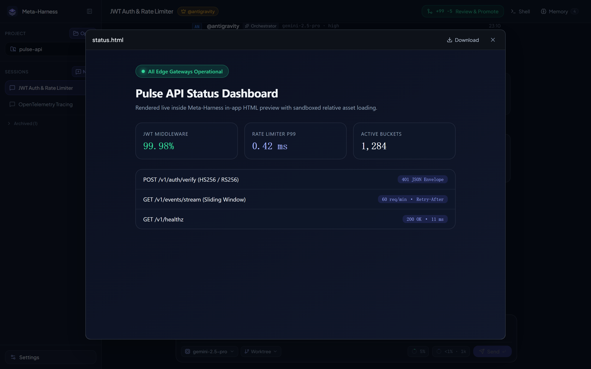

# Meta-Harness Usage Guide

This guide covers day-to-day workflows in Meta-Harness: managing projects and Quick Sessions, orchestrating multi-agent group chats, reviewing diffs, previewing files, using the built-in terminal, and configuring profiles, personas, memory, and storage.

---

## 1. Workspaces: Projects vs. Quick Sessions

Meta-Harness supports three workspace modes from the left sidebar (`Ctrl+B` / `Cmd+B` to collapse or expand):

- **Git-backed Projects.** Click **Open** in the sidebar to choose a local repository. The desktop app opens the system directory picker. A browser connected to the standalone server browses folders on the server. Each session branches from the current `HEAD` into an isolated integration checkout (`mh/<session_id>/integration`) and creates executor checkouts (`mh/<session_id>/exec-<handle>`) as needed.
- **Non-Git Folders.** Folders without `.git` run in serialized **Shared Folder** mode, or you can click **Initialize Git** directly from the sidebar or Welcome screen to enable full worktree isolation.
- **Quick Sessions.** Select **Quick Sessions** in the project switcher to start standalone sessions outside any named repository. Workspaces live under `~/.meta-harness/workspaces/<session_id>` (overridable via `MH_WORKSPACE_DIR`), automatically initialized with Git.

### Archiving, Restoring, & Deleting Sessions

Right-click any session (or click `...`) to **Rename**, **Archive**, or **Delete** it:

- **Archive** checkpoints dirty worktree edits, removes on-disk checkouts to save space, and keeps chat history and Git branches (`mh/<session_id>/*`) intact under the collapsible **Archived (N)** list.
- **Unarchive** restores the integration worktree so you can continue where you left off.
- **Delete** closes the confirmation and continues cleanup in the background while the server runs. The sidebar shows when a session is being removed.
- For **Codex** and supported **Claude Code** adapters, archiving, restoring, and deleting also synchronize linked conversations in the harness's native storage.

---

## 2. Multi-Agent Group Chat & Routing

### Addressing Harnesses

| Prompt pattern | How Meta-Harness routes it |
| :--- | :--- |
| `What does auth.ts do?` *(no `@mention`)* | Routes to the active **Orchestrator** (e.g., `@antigravity`), which can answer directly or call `orchestrator_dispatch` to delegate parallel tasks. |
| `@codex check token expiry` | Routes directly to `@codex` in its isolated executor worktree. |
| `@codex @claude review edge cases` | Dispatches `@codex` and `@claude` in parallel across separate worktrees; clean edits merge automatically into integration. |
| `@codex say hello to @antigravity` | Starts `@codex` first and preserves `@antigravity` in the prompt so Codex can hand off via `@mention`. |
| `@all summarize open risks` | Broadcasts to all available session members. |

When an unmentioned prompt reaches the **Orchestrator**, Meta-Harness supplies current subscription quota headroom, discovered model/effort catalogs, and top matches from **Project Memory** so the orchestrator can pick suitable harnesses, models, and reasoning efforts.

### Project instructions

Harnesses start from their assigned worktree or the shared workspace. Commit project instruction files so they are present in new worktrees. Codex and Antigravity CLI discover `AGENTS.md` in their workspace. Claude Code uses `CLAUDE.md`, which can import a shared file with `@AGENTS.md`. The Gemini CLI fallback uses `GEMINI.md` by default. Personal instructions and installed tools follow the selected harness profile.

### Inter-Harness Collaboration & Activity Timelines

While working concurrently, harnesses connect through Meta-Harness's embedded MCP switch (`meta-harness mcp-bridge`):

- **Async Handoffs:** Harnesses can `@mention` peers in group chat to trigger follow-up turns (bounded by the session hop guard, default 6 hops per user turn). Direct messages sent through the switch show a **To @handle** label.
- **Synchronous Consults (`Sync Consult`):** An active harness can ask an idle peer a question mid-turn and receive the answer before continuing, protected against deadlocks by a live wait-for cycle detector.
- **Trajectory Inspection:** When one harness reads a peer's reasoning steps, tool calls, or diffs (`trajectory_read`), an inline activity pill appears in chat (e.g., `@claude read @codex's trajectory`).
- **Chronological replies:** An agent can post a progress update, another agent can reply, and the first agent can post its final result below that reply. Each part links to the same expandable turn steps. Tool calls, shell output, and skills are shown in those steps.

### Composer Controls & Slash Commands

In the desktop app, right-click selected chat text to copy it or quote it in the composer. The composer and terminal have **Copy** and **Paste** menus. Quoted mentions and slash directives stay in the draft as reference text. The Windows title bar follows the selected theme.

- **Atomic Pills:** `@mentions`, `/commands`, and `/skills` convert into indivisible pills (delete cleanly with a single `Backspace` or click `×`).
  - **Workflow pills** *(passed cleanly as directives)*: `/plan`, `/review`, `/test`, `/fix`
  - **Action pills** *(execute workspace actions immediately)*: `/compact` *(condense older chat context into working summary)*, `/diff`, `/shell`, `/memory`, `/new`, `/archive`
  - **Skill pills** *(preload `SKILL.md` for that turn)*: Any enabled skill such as `/meta-harness-docs` appears in the `/` menu in a distinct skill color; harnesses can also discover and read skills autonomously via `skill_list` / `skill_read` MCP tools or brokered read-only access.
- **Model & Reasoning Effort Selector:** Click the model chip at the bottom-left of the composer to override the model or reasoning effort for the active route—when addressing multiple agents (e.g., `@codex @claude`), each recipient gets its own tab.
- **Image inputs:** Paste an image into the composer or use **Attach images**. A message can contain up to four PNG, JPEG, GIF, or WebP images, each up to 5 MiB. Image-only messages work too. A recipient needs to support ACP image prompts to receive them.
- **Approval Modes:**
  - **Require approval** is the default. Edit files in the workspace and ask before external edits, Internet access, and shell commands that require review.
  - **Approve for me** uses the harness's automatic review where available. Otherwise, the harness and broker approve routine local operations and can still ask for a decision.
  - **Full access** lets the harness edit files and use the network without routine prompts, subject to any provider or administrator restrictions.
  - The mode applies to each persona's next turn. Registered Meta-Harness switch tools get one-time approval in every mode, subject to the switch's own role and dispatch checks.
  - Use `Alt+A` to allow once or `Alt+R` to reject. The card disappears after the decision.
- **Live Quota & Context Rings:** Bottom-right rings display current subscription utilization and per-member context composition (reported directly by ACP when supported, or estimated against the model's context window).

---

## 3. Diff Review, Promotion, & In-App Previews

### Review & Promote Changes

Once an executor turn modifies files on the integration branch, the top header shows the net diff stat (e.g., `+99 -5 Review & Promote`).


- Inspect file-by-file unified diffs inside the modal.
- Choose **Promote to main** (or your repository's base branch) using **Fast-Forward / Merge**, **Squash Merge**, or **Apply Uncommitted Patch**.
- Standalone Quick Sessions track their own integration history (`Review Diff`) without promoting to an external checkout.

### Sandboxed HTML, Code, Image, & PDF Previews

Clicking any workspace file link in a harness message opens the in-app **File Preview** modal:



- **HTML & Web Apps:** Served through short-lived scoped preview grants in a sandboxed iframe so relative CSS, JS, and assets load accurately.
- **Source Code, Images, & PDFs:** Rendered inside the workspace using read-only Monaco Editor syntax highlighting, native image viewer, or PDF.js.

---

## 4. Built-In Multi-Tab Terminal

Toggle the interactive **WebShell** terminal anytime via **Shell** in the header, `/shell` in the composer, or `Ctrl+\`` (`Cmd+\``):


- **True Interactive PTY:** Runs PowerShell / `$SHELL` with full UTF-8 / CJK support, drag-to-resize height, and persistent scrollback across hide/show toggles.
- **Per-Worktree Tabs:** Click `+` in the terminal tab bar to open shells directly inside **`Integration`** or any individual **`@member`** worktree.

---

## 5. Project Memory

Open **Memory** in the top header (or type `/memory`) to view and curate project-wide knowledge stored in SQLite + FTS5:


- **Recent Jobs ("Who Did What"):** Automatically summarizes completed turns across sessions, including the responsible harness, model, touched modules, and outcome. Pin important entries to keep them prioritized.
- **Pinned Architecture & Rules:** Record durable team conventions, ownership notes, or API contracts. Use **Edit fact** to update a note in place or delete it when it no longer applies. Agents can revise their own and other agent-authored facts using the current revision. Search covers both current facts and historical jobs.

---

## 6. Settings, Separate Profiles, Global Personas, & Backups

Open **Settings** in the bottom-left sidebar.


- **Appearance:** Switch between **Obsidian Studio** (default), **Tokyo Night**, **Catppuccin Mocha**, and **Paper Daylight**.
- **Notifications:** Status updates and errors appear in dismissible pop-ups in the app. Opt in to system or browser notifications for approval requests and finished turns while away from the chat. In the standalone web app, click **Enable browser notifications** and keep the tab open to receive them.
- **Harnesses & Models:**
  - Inspect CLI availability, live subscription usage windows, **Check CLI version**, and **Upgrade CLI** where supported.
  - Set adapter-level **Default Model** and **Default Reasoning Effort**.
  - **Separate Profiles:** Click **Create profile & sign in** (or **Use device code** on Codex) to isolate a harness account directory without disturbing your default CLI profile, and switch back anytime with **Use default CLI profile** / **Use saved separate profile**. You can also pin custom directories via `profile_dir` in `harnesses.toml`.
  - **Antigravity:** If the harness asks for authentication, open Harnesses settings and choose to sign in when ready. Open the Google link for that attempt and submit its code or full callback URL. Windows can share credentials through its credential store even when conversation history uses a separate directory.
- **Skills:** Enable/disable installed skills, inspect or edit `SKILL.md` and `references/` files, reset the preinstalled **`Meta-Harness Docs`** (`/meta-harness-docs`) guide, or install additional `SKILL.md` bundles via **Install Folder…**, **Install from Git URL**, or **New Custom Skill**. Repo-local `.agents/skills/` bundles are also discovered automatically.
- **Global Personas:** Define reusable specialist handles (e.g., `@codex-reviewer`) with custom instructions, adapter binding, and default model/effort. New sessions automatically include templates whose harness is installed, or click **Add to session** for an active chat.
- **Session:** Reassign the session **Orchestrator**, manage active member models/personas, adjust approval policy, tune **Max Agent Hops** (`2–16`), and prune saved command allow-rules.
- **Network** shows the server proxy status and a **Check now** button for an explicit proxy. Meta-Harness checks the proxy at startup and every minute by requesting HTTP 204 from `https://www.gstatic.com/generate_204`. A failed check switches to direct connections and shows **Proxy not used**. A successful check restores proxy routing. The desktop app saves the proxy URL and restarts when you change it. The standalone app reads its explicit URL from `--proxy` at startup.
- New network requests and subprocesses follow the current route. ACP harnesses switch on their next turn. A running turn or an open shell keeps its launch environment.
- **Storage & Data:**
  - View itemized disk usage across SQLite DB, active project worktrees, Quick Sessions, archived sessions, and orphan caches.
  - Run **Clear Caches & Orphans** or **Delete Archived Sessions**.
  - **Settings backup:** Export/import versioned JSON containing your theme, harness model defaults, quota preferences, and global personas.
- **About:** Displays app version, 6-character build commit, and repository link. Open third-party license notices in the read-only viewer.

---

## 7. CLI Flags, Environment Overrides, & Remote Access

Launch Meta-Harness as a standard user. The app refuses Unix root and elevated Windows launches.

```sh
meta-harness [OPTIONS]
meta-harness serve [OPTIONS]
```

| Flag / Env Var | Description | Default |
| :--- | :--- | :--- |
| `--bind <ADDR:PORT>` | Listen on this address for web and terminal traffic | `127.0.0.1:4410` |
| `--tls-cert <PATH>`, `--tls-key <PATH>` | PEM certificate chain and private key for HTTPS | Required for a non-loopback bind |
| `--auth-token <TOKEN>` | Require pairing with a supplied token of at least 24 characters | Random generated token when binding outside loopback |
| `--no-open` | Do not automatically launch a browser tab | Opens on loopback |
| `--no-tray` | Run in the foreground without system tray / menu bar icon | Tray enabled on Windows/macOS releases |
| `--config <PATH>` | Path to `harnesses.toml` configuration | Auto-discovered |
| `--proxy <URL>` | Outbound proxy for the server and its child processes. Failed checks switch to direct routing and successful checks restore the proxy. | Startup proxy environment or Windows manual proxy |
| `--data-dir <PATH>` | Override SQLite database & app data directory | OS app-data dir |
| `MH_CONFIG_DIR`, `MH_DATA_DIR`, `MH_WORKSPACE_DIR` | Override config, data, and Quick Session directories | OS standard dirs / `~/.meta-harness/workspaces` |

Direct LAN access requires HTTPS. Supply a certificate trusted by your clients and use the hostname or IP address on that certificate when opening the pairing URL. The `#token=…` fragment is exchanged for a browser session that expires after 24 hours. Chat and terminal WebSockets close at expiry, and the browser prompts for pairing again. API clients can send `Authorization: Bearer <TOKEN>` over HTTPS.

For example, `meta-harness serve --proxy http://127.0.0.1:7890` configures the machine running the server. Browsers opening the web UI use their own network settings. The server keeps its loopback connections direct.

```sh
meta-harness serve --bind harness.example:4410 --tls-cert fullchain.pem --tls-key key.pem
```

For an existing HTTPS reverse proxy, keep Meta-Harness on `127.0.0.1`, set a strong `--auth-token`, and forward the original `Host` header and WebSocket upgrades. Open the proxy's HTTPS URL and enter the token at the pairing prompt. Pairing grants access to the workspace and the server user's terminal.
