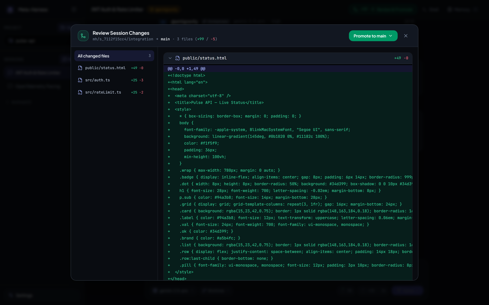
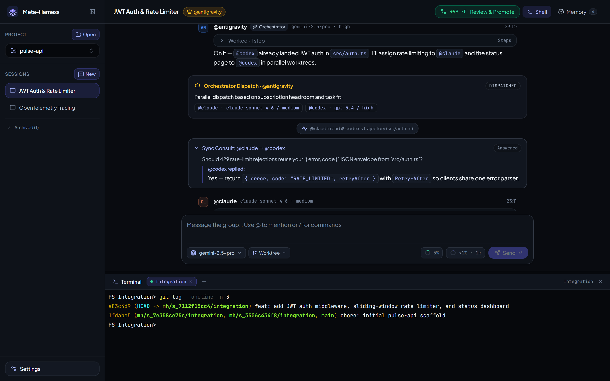
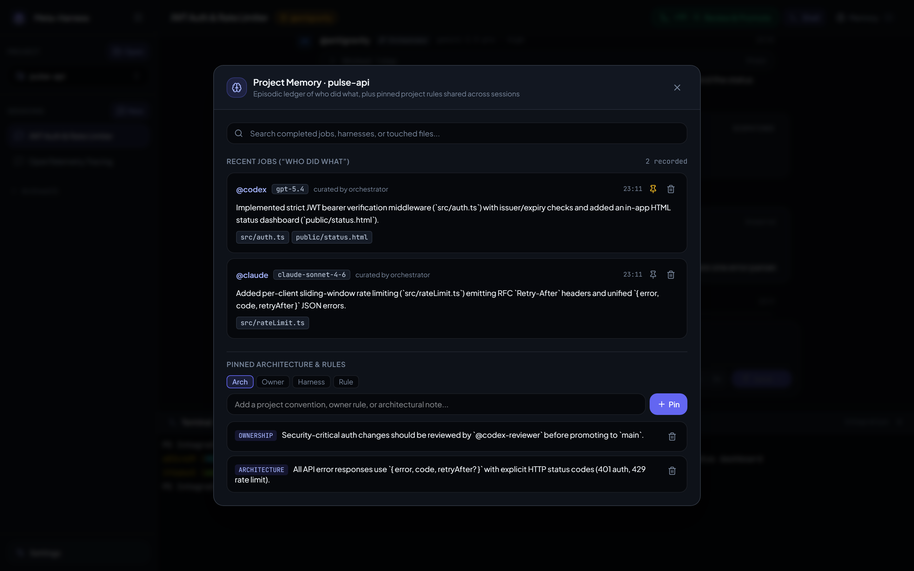
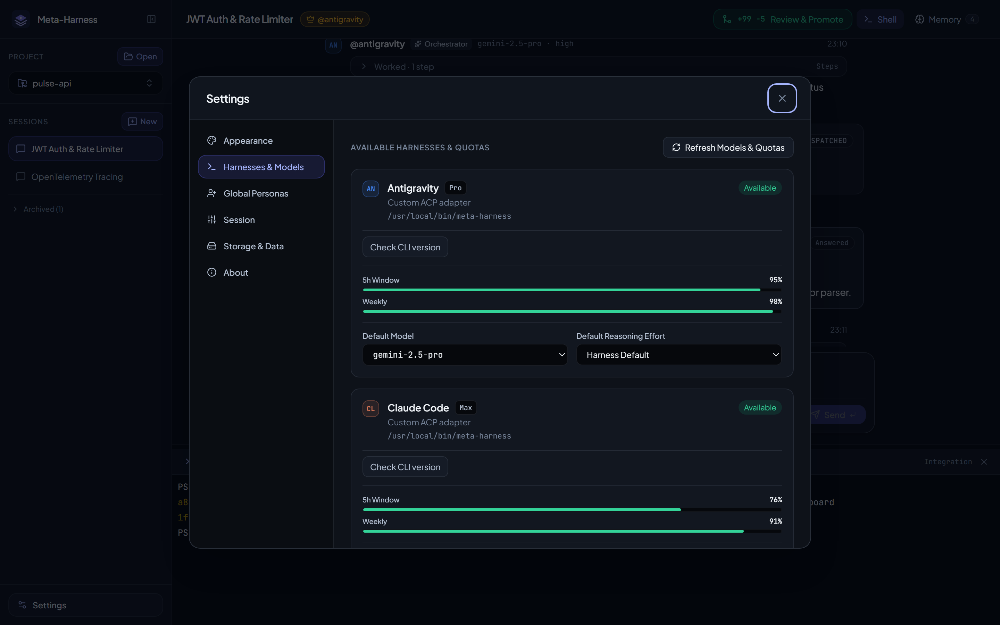

# Meta-Harness Usage Guide

This guide covers day-to-day workflows in Meta-Harness: managing projects and Quick Sessions, orchestrating multi-agent group chats, reviewing diffs, previewing files, using the built-in terminal, and configuring profiles, personas, memory, and storage.

---

## 1. Workspaces: Projects vs. Quick Sessions

Meta-Harness supports three workspace modes from the left sidebar (`Ctrl+B` / `Cmd+B` to collapse or expand):

- **Git-backed Projects (Recommended).** Click **Open** in the sidebar to browse and open a local repository. Each session automatically branches from your current `HEAD` into an isolated integration checkout (`mh/<session_id>/integration`) and spins up per-executor checkouts (`mh/<session_id>/exec-<handle>`) on demand—keeping your main working tree untouched until you choose to promote changes.
- **Non-Git Folders.** Folders without `.git` run in serialized **Shared Folder** mode, or you can click **Initialize Git** directly from the sidebar or Welcome screen to enable full worktree isolation.
- **Quick Sessions.** Select **Quick Sessions** in the project switcher to start standalone sessions outside any named repository. Workspaces live under `~/.meta-harness/workspaces/<session_id>` (overridable via `MH_WORKSPACE_DIR`), automatically initialized with Git.

### Archiving, Restoring, & Deleting Sessions

Right-click any session (or click `...`) to **Rename**, **Archive**, or **Delete** it:

- **Archive** checkpoints dirty worktree edits, removes on-disk checkouts to save space, and keeps chat history and Git branches (`mh/<session_id>/*`) intact under the collapsible **Archived (N)** list.
- **Unarchive** restores the integration worktree so you can continue where you left off.
- For **Codex** and supported **Claude Code** adapters, archiving, restoring, and deleting also synchronize linked conversations in the harness's native storage.

---

## 2. Multi-Agent Group Chat & Routing

### Addressing Harnesses

| Prompt pattern | How Meta-Harness routes it |
| :--- | :--- |
| `What does auth.ts do?` *(no `@mention`)* | Routes to the active **Orchestrator** (e.g., `@antigravity`), which can answer directly or call `orchestrator_dispatch` to delegate parallel tasks. |
| `@codex check token expiry` | Routes directly to `@codex` in its isolated executor worktree. |
| `@codex @claude review edge cases` | Dispatches `@codex` and `@claude` in parallel across separate worktrees; clean edits merge automatically into integration. |
| `@codex say hello to @antigravity` | Starts `@codex` first and preserves `@antigravity` in the prompt so Codex can hand off via `@mention`. |
| `@all summarize open risks` | Broadcasts to all available session members. |

When an unmentioned prompt reaches the **Orchestrator**, Meta-Harness supplies current subscription quota headroom, discovered model/effort catalogs, and top matches from **Project Memory** so the orchestrator can pick suitable harnesses, models, and reasoning efforts.

### Project instructions

Harnesses start from their assigned worktree or the shared workspace. Commit project instruction files so they are present in new worktrees. Codex and Antigravity CLI discover `AGENTS.md` in their workspace. Claude Code uses `CLAUDE.md`, which can import a shared file with `@AGENTS.md`. The Gemini CLI fallback uses `GEMINI.md` by default. Personal instructions and installed tools follow the selected harness profile.

### Inter-Harness Collaboration & Activity Timelines

While working concurrently, harnesses connect through Meta-Harness's embedded MCP switch (`meta-harness mcp-bridge`):

- **Async Handoffs:** Harnesses can `@mention` peers in group chat to trigger follow-up turns (bounded by the session hop guard, default 6 hops per user turn).
- **Synchronous Consults (`Sync Consult`):** An active harness can ask an idle peer a question mid-turn and receive the answer before continuing, protected against deadlocks by a live wait-for cycle detector.
- **Trajectory Inspection:** When one harness reads a peer's reasoning steps, tool calls, or diffs (`trajectory_read`), an inline activity pill appears in chat (e.g., `@claude read @codex's trajectory`).
- **Clean Multi-Step Messages:** Tool calls, shell output, and intermediate notes collapse into expandable **`Worked · N steps`** timelines above the final response.

### Composer Controls & Slash Commands

- **Atomic Pills:** `@mentions`, `/commands`, and `/skills` convert into indivisible pills (delete cleanly with a single `Backspace` or click `×`).
  - **Workflow pills** *(passed cleanly as directives)*: `/plan`, `/review`, `/test`, `/fix`
  - **Action pills** *(execute workspace actions immediately)*: `/compact` *(condense older chat context into working summary)*, `/diff`, `/shell`, `/memory`, `/new`, `/archive`
  - **Skill pills** *(preload `SKILL.md` for that turn)*: Any enabled skill such as `/meta-harness-docs` appears in the `/` menu in a distinct skill color; harnesses can also discover and read skills autonomously via `skill_list` / `skill_read` MCP tools or brokered read-only access.
- **Model & Reasoning Effort Selector:** Click the model chip at the bottom-left of the composer to override the model or reasoning effort for the active route—when addressing multiple agents (e.g., `@codex @claude`), each recipient gets its own tab.
- **Approval Modes:**
  - **Worktree** (`worktree_smart`) — Default. Allows file reads/writes inside the member worktree and prompts before running shell commands (with optional session-wide allow patterns).
  - **Strict** (`strict`) — Prompts on both file writes and shell executions.
  - **Auto** (`autonomous_sandbox`) — Auto-allows worktree edits and safe local commands while prompting on risky/external actions.
  - Keyboard shortcuts when an approval card is pending: `Alt+A` to allow once, `Alt+R` to reject.
- **Live Quota & Context Rings:** Bottom-right rings display current subscription utilization and per-member context composition (reported directly by ACP when supported, or estimated against the model's context window).

---

## 3. Diff Review, Promotion, & In-App Previews

### Review & Promote Changes

Once an executor turn modifies files on the integration branch, the top header shows the net diff stat (e.g., `+99 -5 Review & Promote`).



- Inspect file-by-file unified diffs inside the modal.
- Choose **Promote to main** (or your repository's base branch) using **Fast-Forward / Merge**, **Squash Merge**, or **Apply Uncommitted Patch**.
- Standalone Quick Sessions track their own integration history (`Review Diff`) without promoting to an external checkout.

### Sandboxed HTML, Code, Image, & PDF Previews

Clicking any workspace file link in a harness message opens the in-app **File Preview** modal:


- **HTML & Web Apps:** Served through short-lived scoped preview grants in a sandboxed iframe so relative CSS, JS, and assets load accurately.
- **Source Code, Images, & PDFs:** Rendered inside the workspace using read-only Monaco Editor syntax highlighting, native image viewer, or PDF.js.

---

## 4. Built-In Multi-Tab Terminal

Toggle the interactive **WebShell** terminal anytime via **Shell** in the header, `/shell` in the composer, or `Ctrl+\`` (`Cmd+\``):



- **True Interactive PTY:** Runs PowerShell / `$SHELL` with full UTF-8 / CJK support, drag-to-resize height, and persistent scrollback across hide/show toggles.
- **Per-Worktree Tabs:** Click `+` in the terminal tab bar to open shells directly inside **`Integration`** or any individual **`@member`** worktree.

---

## 5. Project Memory

Open **Memory** in the top header (or type `/memory`) to view and curate project-wide knowledge stored in SQLite + FTS5:



- **Recent Jobs ("Who Did What"):** Automatically summarizes completed turns across sessions, including the responsible harness, model, touched modules, and outcome. Pin important entries to keep them prioritized.
- **Pinned Architecture & Rules:** Record durable team conventions, ownership notes, or API contracts so the Orchestrator and executors recall them automatically in future sessions.

---

## 6. Settings, Separate Profiles, Global Personas, & Backups

Click **Settings** in the bottom-left sidebar to manage six sections:



- **Appearance:** Switch between **Obsidian Studio** (default), **Tokyo Night**, **Catppuccin Mocha**, and **Paper Daylight**.
- **Harnesses & Models:**
  - Inspect CLI availability, live subscription usage windows, **Check CLI version**, and **Upgrade CLI** where supported.
  - Set adapter-level **Default Model** and **Default Reasoning Effort**.
  - **Separate Profiles:** Click **Create profile & sign in** (or **Use device code** on Codex) to isolate a harness account directory without disturbing your default CLI profile, and switch back anytime with **Use default CLI profile** / **Use saved separate profile**. You can also pin custom directories via `profile_dir` in `harnesses.toml`.
- **Skills:** Enable/disable installed skills, inspect or edit `SKILL.md` and `references/` files, reset the preinstalled **`Meta-Harness Docs`** (`/meta-harness-docs`) guide, or install additional `SKILL.md` bundles via **Install Folder…**, **Install from Git URL**, or **New Custom Skill**. Repo-local `.agents/skills/` bundles are also discovered automatically.
- **Global Personas:** Define reusable specialist handles (e.g., `@codex-reviewer`) with custom instructions, adapter binding, and default model/effort. New sessions automatically include templates whose harness is installed, or click **Add to session** for an active chat.
- **Session:** Reassign the session **Orchestrator**, manage active member models/personas, adjust approval policy, tune **Max Agent Hops** (`2–16`), and prune saved command allow-rules.
- **Storage & Data:**
  - View itemized disk usage across SQLite DB, active project worktrees, Quick Sessions, archived sessions, and orphan caches.
  - Run **Clear Caches & Orphans** or **Delete Archived Sessions**.
  - **Settings backup:** Export/import versioned JSON containing your theme, harness model defaults, quota preferences, and global personas.
- **About:** Displays app version, 6-character build commit, repository link, and third-party license notices.

---

## 7. CLI Flags, Environment Overrides, & Remote Access

```sh
meta-harness [OPTIONS]
meta-harness serve [OPTIONS]
```

| Flag / Env Var | Description | Default |
| :--- | :--- | :--- |
| `--bind <ADDR:PORT>` | Bind address for HTTP/WebSocket server | `127.0.0.1:4410` |
| `--auth-token <TOKEN>` | Explicit bearer token for non-loopback binds | Random generated token |
| `--no-open` | Do not automatically launch a browser tab | Opens on loopback |
| `--no-tray` | Run in the foreground without system tray / menu bar icon | Tray enabled on Windows/macOS releases |
| `--config <PATH>` | Path to `harnesses.toml` configuration | Auto-discovered |
| `--data-dir <PATH>` | Override SQLite database & app data directory | OS app-data dir |
| `MH_CONFIG_DIR`, `MH_DATA_DIR`, `MH_WORKSPACE_DIR` | Override config, data, and Quick Session directories | OS standard dirs / `~/.meta-harness/workspaces` |

When `--bind` is set to a non-loopback address (for example `0.0.0.0:4410` over LAN or Tailscale), Meta-Harness requires pairing via `?token=<TOKEN>` (exchanged for an `HttpOnly` session cookie) or an `Authorization: Bearer <TOKEN>` header.
